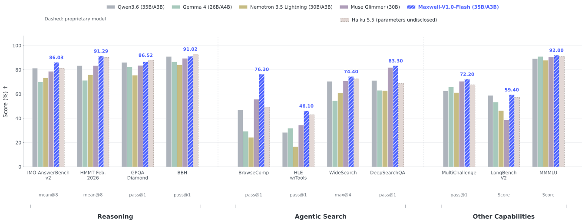
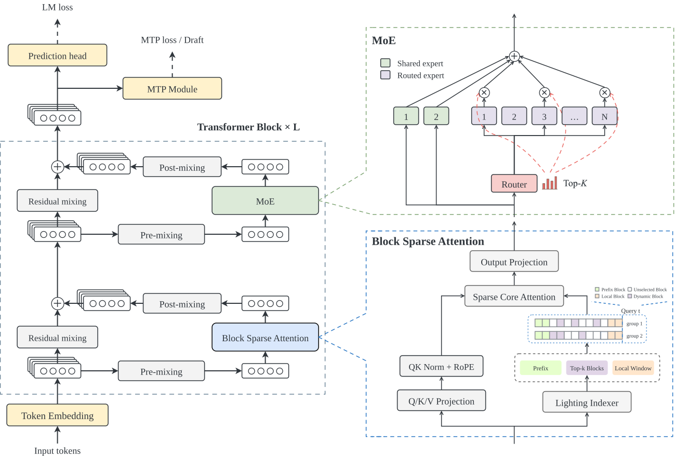

<br>

<div align="center">
  <br>
</div>

<br>

<div align="center" style="line-height: 0;">
    <span style="display: inline-flex; align-items: center; gap: 6px;">
        <a href="https://maxwell-llm.ai/"></a>
        <a href="https://maxwell-llm.ai/playground"></a>
        <a href="https://discord.gg/SM7Bxz9XQU"></a>
    </span>
</div>

<div align="center" style="line-height: 0; padding-top: 3px;">
    <span style="display: inline-flex; align-items: center; gap: 6px;">
        <a href="https://huggingface.co/maxwell-model/Maxwell-V1-Flash"></a>
        <a href="#7-license"></a>
    </span>
</div>

<br>

<div align="center" style="font-size: 15px;">
    📄&nbsp;<a href="https://github.com/maxwell-model/Maxwell-V1-Flash/blob/main/Maxwell_v1_flash_tech_report.pdf" style="color: inherit; text-decoration: underline;">Technical Report</a>&nbsp;&nbsp;|&nbsp;&nbsp;
    💬&nbsp;<a href="https://github.com/maxwell-model/Maxwell-V1-Flash" style="color: inherit; text-decoration: underline;">GitHub</a>
</div>

<br>

## 1. Introduction

We present **Maxwell-V1.0-Flash**, a high-performance Mixture-of-Experts (MoE)
language model with **35B total parameters and 3B active parameters per token**,
supporting a context window of up to **256K tokens**. Maxwell combines learned
block-sparse attention, fine-grained expert routing, and manifold-constrained
hyper-connections for efficient long-context inference. It is pre-trained on
approximately 26T multilingual tokens with the Muon optimizer and multi-token
prediction, followed by two-stage supervised fine-tuning, specialized
reinforcement learning, and multi-teacher on-policy distillation. Together,
these choices deliver strong reasoning, agentic search, and broad general
capabilities.

<div align="center">
    
</div>

## 2. Model Summary

Maxwell-V1.0-Flash uses a 45-layer decoder-only Transformer backbone. Its
feed-forward stack begins with 3 dense layers followed by 42 MoE layers, while
block-sparse attention and manifold-constrained hyper-connections support
selective context access and information flow across residual streams.

<div align="center">
    
</div>

#### Maxwell Block Sparse Attention

Maxwell Block Sparse Attention (MBSA) combines fixed prefix and local coverage
with learned remote block selection. Each KV group attends to up to 32 blocks,
capping support at 4,096 tokens while retaining full-history KV. MBSA delivers
a 6.7x kernel speedup over dense GQA at 256K under matched shapes.

#### Manifold-Constrained Hyper-Connections

Four residual streams use learned input-dependent aggregation and constrained
mixing with 20 Sinkhorn-Knopp iterations. This expands information flow across
the network without adding extra attention or feed-forward evaluations.

#### Fine-Grained Mixture of Experts

The first 3 decoder layers use dense feed-forward networks, followed by 42 MoE
layers. Each MoE layer contains 256 routed experts, activates 12 per token, and
includes 2 always-active shared experts, with a dynamic selection bias for
auxiliary-loss-free load balancing.

#### Pre-training and Long Context

Maxwell-V1.0-Flash is pre-trained on approximately 26T multilingual tokens using
the Muon optimizer and an auxiliary multi-token prediction objective. Context
length is progressively extended from 4K to 256K, with block-sparse attention
introduced during mid-training after indexer warm-up.

#### Post-training

Two-stage supervised fine-tuning establishes general, reasoning, and agentic
capabilities. Independent reinforcement-learning branches then specialize these
capabilities, and multi-teacher on-policy distillation consolidates them into a
single model.

## 3. Model Links

| Model Name | Description                               | Hugging Face |
|:---|:------------------------------------------|:---:|
| Maxwell-V1-Flash | 35B-total / 3B-active MoE model | [🤗 Hugging Face](https://huggingface.co/maxwell-model/Maxwell-V1-Flash) |

The model repository above contains the official Maxwell-V1.0-Flash release
used by the examples in this repository.

## 4. Evaluation Results

**Base model.** Maxwell-V1.0-Flash (Base) is compared with two Qwen base models of
comparable scale under a unified internal evaluation framework. All scores are
percentages; the best score in each row is shown in bold. GSM8K is evaluated
using pass@8.

| Category | Benchmark | Qwen3.0-w30a3-base | Qwen3.5-w35a3-base | Maxwell-V1.0-Flash (Base) |
|:---|:---|:---:|:---:|:---:|
| Math | GSM8K (pass@8) | 97.95 | **98.41** | 97.19 |
| | MATH-500 | 59.00 | 57.50 | **71.40** |
| | MinervaMath (MATH) | 62.14 | 58.62 | **74.56** |
| | MathQA | 60.40 | 63.69 | **66.10** |
| Code | HumanEval | 70.73 | 67.68 | **78.05** |
| | MBPP | **73.93** | 61.09 | 65.37 |
| | HumanEval+ | 63.41 | 56.10 | **71.95** |
| | MBPP+ | **75.40** | 70.90 | 75.13 |
| STEM | MMLU | 80.98 | **82.85** | 79.85 |
| | MMLU-Redux | **78.17** | **78.17** | 74.90 |
| | MMLU-Pro | 61.64 | 64.68 | **65.25** |
| | ARC-Easy | 80.01 | 82.15 | **86.78** |
| | ARC-Challenge | 57.59 | 62.12 | **65.78** |
| | BBH | 28.08 | 52.17 | **57.01** |
| | GPQA-main | 40.62 | **54.69** | 52.68 |
| | GPQA-diamond | 42.42 | **54.04** | 51.52 |
| Multilingual | MMLU (SEA) | 73.89 | **77.37** | 75.06 |
| | XCOPA (SEA) | 79.63 | 78.93 | **79.80** |
| | OpenBookQA (SEA) | 43.20 | 41.30 | **43.30** |
| | ARC-Challenge (SEA) | 51.83 | 54.67 | **58.13** |
| | MGSM | **85.20** | 84.13 | 83.87 |
| Knowledge | HellaSwag | 81.38 | **83.64** | 79.84 |
| | PIQA | 81.12 | **82.54** | **82.54** |
| | WinoGrande | **77.74** | 74.11 | 72.30 |
| | TriviaQA | 66.66 | 71.01 | **75.02** |
| | RACE | **86.89** | 81.15 | 84.88 |
| | OpenBookQA | **90.00** | 88.60 | 89.60 |
| Chinese | CMMLU | **87.41** | 86.17 | 79.41 |
| | C-Eval | **88.78** | 86.33 | 77.41 |

**Base model, long context.** Scores are on a 0–100 scale. All results use
block-sparse attention in every layer.

| Benchmark | Context length | Qwen3.5-w35a3-base | Maxwell-V1.0-Flash (Base) |
|:---|:---:|:---:|:---:|
| RULER | 8K | 91.98 | **94.80** |
| | 16K | 91.44 | **94.72** |
| | 32K | 90.91 | **94.63** |
| | 64K | 89.65 | **93.77** |
| | 128K | 88.39 | **94.57** |
| | 256K | 85.75 | **93.35** |
| HELMET | 8K | 56.62 | **62.61** |
| | 16K | 54.93 | **61.43** |
| | 32K | 56.87 | **60.28** |
| | 64K | 54.61 | **58.74** |
| | 128K | 52.35 | **56.55** |

**Post-trained model.** Maxwell-V1.0-Flash is compared with four models of
comparable scale: Qwen3.6-35B-A3B, Gemma-4-26B-A4B-it,
Nemotron-3.5-Lightning, and Muse-Glimmer-30B. All scores are percentages;
the highest score for each metric is shown in bold. Multilingual results
cover only market languages. Model names wrap across lines to keep the complete
comparison compact.

<table style="border-collapse: collapse; width: 100%; border: 1px solid #e4eaf1; border-radius: 4px; table-layout: fixed;">
  <thead>
    <tr>
      <th align="left" style="background-color: #f7f9fc; padding: 8px 9px; border-bottom: 1px solid #e4eaf1; border-right: 1px solid #eef2f6; vertical-align: middle; text-align: left; white-space: normal; overflow-wrap: anywhere; width: 28%; border-top: 0;">Benchmark (Metric)</th>
      <th align="left" style="background-color: #f7f9fc; padding: 8px 9px; border-bottom: 1px solid #e4eaf1; border-right: 1px solid #eef2f6; vertical-align: middle; text-align: left; white-space: normal; overflow-wrap: anywhere; width: 14.4%; border-top: 0;">Qwen3.6<br/>35B-A3B</th>
      <th align="left" style="background-color: #f7f9fc; padding: 8px 9px; border-bottom: 1px solid #e4eaf1; border-right: 1px solid #eef2f6; vertical-align: middle; text-align: left; white-space: normal; overflow-wrap: anywhere; width: 14.4%; border-top: 0;">Gemma-4<br/>26B-A4B-it</th>
      <th align="left" style="background-color: #f7f9fc; padding: 8px 9px; border-bottom: 1px solid #e4eaf1; border-right: 1px solid #eef2f6; vertical-align: middle; text-align: left; white-space: normal; overflow-wrap: anywhere; width: 14.4%; border-top: 0;">Nemotron-3.5<br/>Lightning</th>
      <th align="left" style="background-color: #f7f9fc; padding: 8px 9px; border-bottom: 1px solid #e4eaf1; border-right: 1px solid #eef2f6; vertical-align: middle; text-align: left; white-space: normal; overflow-wrap: anywhere; width: 14.4%; border-top: 0;">Muse<br/>Glimmer-30B</th>
      <th align="left" style="background-color: #f8faff; padding: 8px 9px; border-bottom: 1px solid #e4eaf1; vertical-align: middle; text-align: left; white-space: normal; overflow-wrap: anywhere; width: 14.4%; border-top: 0;">Maxwell<br/>V1.0-Flash</th>
    </tr>
  </thead>
  <tbody style="border-top: 0; border-bottom: 0;">
    <tr><th align="left" colspan="6" style="background-color: #f2f5f8; padding: 8px 9px; border-bottom: 1px solid #e4eaf1; vertical-align: top; text-align: left; white-space: normal; overflow-wrap: anywhere; border-top: 0;">General</th></tr>
    <tr>
      <td align="left" style="background-color: #fff; padding: 10px 9px; border-bottom: 1px solid #e4eaf1; border-right: 1px solid #eef2f6; vertical-align: top; text-align: left; white-space: normal; overflow-wrap: anywhere; border-top: 0;"><strong>Instruction following</strong></td>
      <td align="left" style="background-color: #fff; padding: 8px 9px; border-bottom: 1px solid #e4eaf1; border-right: 1px solid #eef2f6; vertical-align: top; text-align: left; white-space: normal; overflow-wrap: anywhere;"></td>
      <td align="left" style="background-color: #fff; padding: 8px 9px; border-bottom: 1px solid #e4eaf1; border-right: 1px solid #eef2f6; vertical-align: top; text-align: left; white-space: normal; overflow-wrap: anywhere;"></td>
      <td align="left" style="background-color: #fff; padding: 8px 9px; border-bottom: 1px solid #e4eaf1; border-right: 1px solid #eef2f6; vertical-align: top; text-align: left; white-space: normal; overflow-wrap: anywhere;"></td>
      <td align="left" style="background-color: #fff; padding: 8px 9px; border-bottom: 1px solid #e4eaf1; border-right: 1px solid #eef2f6; vertical-align: top; text-align: left; white-space: normal; overflow-wrap: anywhere;"></td>
      <td align="left" style="background-color: #fff; padding: 8px 9px; border-bottom: 1px solid #e4eaf1; vertical-align: top; text-align: left; white-space: normal; overflow-wrap: anywhere;"></td>
    </tr>
    <tr>
      <td align="left" style="background-color: #fff; padding: 8px 9px; border-bottom: 1px solid #e4eaf1; border-right: 1px solid #eef2f6; vertical-align: top; text-align: left; white-space: normal; overflow-wrap: anywhere;">AdvancedIF <span>(Score)</span></td>
      <td align="left" style="background-color: #fff; padding: 8px 9px; border-bottom: 1px solid #e4eaf1; border-right: 1px solid #eef2f6; vertical-align: top; text-align: left; white-space: normal; overflow-wrap: anywhere;">72.50</td>
      <td align="left" style="background-color: #fff; padding: 8px 9px; border-bottom: 1px solid #e4eaf1; border-right: 1px solid #eef2f6; vertical-align: top; text-align: left; white-space: normal; overflow-wrap: anywhere;"><strong>76.10</strong></td>
      <td align="left" style="background-color: #fff; padding: 8px 9px; border-bottom: 1px solid #e4eaf1; border-right: 1px solid #eef2f6; vertical-align: top; text-align: left; white-space: normal; overflow-wrap: anywhere;">65.60</td>
      <td align="left" style="background-color: #fff; padding: 8px 9px; border-bottom: 1px solid #e4eaf1; border-right: 1px solid #eef2f6; vertical-align: top; text-align: left; white-space: normal; overflow-wrap: anywhere;">73.80</td>
      <td align="left" style="background-color: #f8faff; padding: 8px 9px; border-bottom: 1px solid #e4eaf1; vertical-align: top; text-align: left; white-space: normal; overflow-wrap: anywhere;">71.30</td>
    </tr>
    <tr>
      <td align="left" style="background-color: #fff; padding: 8px 9px; border-bottom: 1px solid #e4eaf1; border-right: 1px solid #eef2f6; vertical-align: top; text-align: left; white-space: normal; overflow-wrap: anywhere;">IFBench <span>(Score)</span></td>
      <td align="left" style="background-color: #fff; padding: 8px 9px; border-bottom: 1px solid #e4eaf1; border-right: 1px solid #eef2f6; vertical-align: top; text-align: left; white-space: normal; overflow-wrap: anywhere;">59.60</td>
      <td align="left" style="background-color: #fff; padding: 8px 9px; border-bottom: 1px solid #e4eaf1; border-right: 1px solid #eef2f6; vertical-align: top; text-align: left; white-space: normal; overflow-wrap: anywhere;">79.10</td>
      <td align="left" style="background-color: #fff; padding: 8px 9px; border-bottom: 1px solid #e4eaf1; border-right: 1px solid #eef2f6; vertical-align: top; text-align: left; white-space: normal; overflow-wrap: anywhere;">70.80</td>
      <td align="left" style="background-color: #fff; padding: 8px 9px; border-bottom: 1px solid #e4eaf1; border-right: 1px solid #eef2f6; vertical-align: top; text-align: left; white-space: normal; overflow-wrap: anywhere;"><strong>83.20</strong></td>
      <td align="left" style="background-color: #f8faff; padding: 8px 9px; border-bottom: 1px solid #e4eaf1; vertical-align: top; text-align: left; white-space: normal; overflow-wrap: anywhere;">64.80</td>
    </tr>
    <tr>
      <td align="left" style="background-color: #fff; padding: 8px 9px; border-bottom: 1px solid #e4eaf1; border-right: 1px solid #eef2f6; vertical-align: top; text-align: left; white-space: normal; overflow-wrap: anywhere;">IFEval <span>(Score)</span></td>
      <td align="left" style="background-color: #fff; padding: 8px 9px; border-bottom: 1px solid #e4eaf1; border-right: 1px solid #eef2f6; vertical-align: top; text-align: left; white-space: normal; overflow-wrap: anywhere;">93.80</td>
      <td align="left" style="background-color: #fff; padding: 8px 9px; border-bottom: 1px solid #e4eaf1; border-right: 1px solid #eef2f6; vertical-align: top; text-align: left; white-space: normal; overflow-wrap: anywhere;">94.00</td>
      <td align="left" style="background-color: #fff; padding: 8px 9px; border-bottom: 1px solid #e4eaf1; border-right: 1px solid #eef2f6; vertical-align: top; text-align: left; white-space: normal; overflow-wrap: anywhere;">91.50</td>
      <td align="left" style="background-color: #fff; padding: 8px 9px; border-bottom: 1px solid #e4eaf1; border-right: 1px solid #eef2f6; vertical-align: top; text-align: left; white-space: normal; overflow-wrap: anywhere;"><strong>96.80</strong></td>
      <td align="left" style="background-color: #f8faff; padding: 8px 9px; border-bottom: 1px solid #e4eaf1; vertical-align: top; text-align: left; white-space: normal; overflow-wrap: anywhere;">93.00</td>
    </tr>
    <tr>
      <td align="left" style="background-color: #fff; padding: 8px 9px; border-bottom: 1px solid #e4eaf1; border-right: 1px solid #eef2f6; vertical-align: top; text-align: left; white-space: normal; overflow-wrap: anywhere;"><em>Instruction-following average</em> <span>(Average)</span></td>
      <td align="left" style="background-color: #fff; padding: 8px 9px; border-bottom: 1px solid #e4eaf1; border-right: 1px solid #eef2f6; vertical-align: top; text-align: left; white-space: normal; overflow-wrap: anywhere;">75.30</td>
      <td align="left" style="background-color: #fff; padding: 8px 9px; border-bottom: 1px solid #e4eaf1; border-right: 1px solid #eef2f6; vertical-align: top; text-align: left; white-space: normal; overflow-wrap: anywhere;">83.07</td>
      <td align="left" style="background-color: #fff; padding: 8px 9px; border-bottom: 1px solid #e4eaf1; border-right: 1px solid #eef2f6; vertical-align: top; text-align: left; white-space: normal; overflow-wrap: anywhere;">75.97</td>
      <td align="left" style="background-color: #fff; padding: 8px 9px; border-bottom: 1px solid #e4eaf1; border-right: 1px solid #eef2f6; vertical-align: top; text-align: left; white-space: normal; overflow-wrap: anywhere;"><strong>84.60</strong></td>
      <td align="left" style="background-color: #f8faff; padding: 8px 9px; border-bottom: 1px solid #e4eaf1; vertical-align: top; text-align: left; white-space: normal; overflow-wrap: anywhere;">76.37</td>
    </tr>
    <tr>
      <td align="left" style="background-color: #fff; padding: 10px 9px; border-bottom: 1px solid #e4eaf1; border-right: 1px solid #eef2f6; vertical-align: top; text-align: left; white-space: normal; overflow-wrap: anywhere; border-top: 0;"><strong>Multi-turn</strong></td>
      <td align="left" style="background-color: #fff; padding: 8px 9px; border-bottom: 1px solid #e4eaf1; border-right: 1px solid #eef2f6; vertical-align: top; text-align: left; white-space: normal; overflow-wrap: anywhere;"></td>
      <td align="left" style="background-color: #fff; padding: 8px 9px; border-bottom: 1px solid #e4eaf1; border-right: 1px solid #eef2f6; vertical-align: top; text-align: left; white-space: normal; overflow-wrap: anywhere;"></td>
      <td align="left" style="background-color: #fff; padding: 8px 9px; border-bottom: 1px solid #e4eaf1; border-right: 1px solid #eef2f6; vertical-align: top; text-align: left; white-space: normal; overflow-wrap: anywhere;"></td>
      <td align="left" style="background-color: #fff; padding: 8px 9px; border-bottom: 1px solid #e4eaf1; border-right: 1px solid #eef2f6; vertical-align: top; text-align: left; white-space: normal; overflow-wrap: anywhere;"></td>
      <td align="left" style="background-color: #fff; padding: 8px 9px; border-bottom: 1px solid #e4eaf1; vertical-align: top; text-align: left; white-space: normal; overflow-wrap: anywhere;"></td>
    </tr>
    <tr>
      <td align="left" style="background-color: #fff; padding: 8px 9px; border-bottom: 1px solid #e4eaf1; border-right: 1px solid #eef2f6; vertical-align: top; text-align: left; white-space: normal; overflow-wrap: anywhere;">MultiChallenge <span>(pass@1)</span></td>
      <td align="left" style="background-color: #fff; padding: 8px 9px; border-bottom: 1px solid #e4eaf1; border-right: 1px solid #eef2f6; vertical-align: top; text-align: left; white-space: normal; overflow-wrap: anywhere;">62.59</td>
      <td align="left" style="background-color: #fff; padding: 8px 9px; border-bottom: 1px solid #e4eaf1; border-right: 1px solid #eef2f6; vertical-align: top; text-align: left; white-space: normal; overflow-wrap: anywhere;">65.76</td>
      <td align="left" style="background-color: #fff; padding: 8px 9px; border-bottom: 1px solid #e4eaf1; border-right: 1px solid #eef2f6; vertical-align: top; text-align: left; white-space: normal; overflow-wrap: anywhere;">61.07</td>
      <td align="left" style="background-color: #fff; padding: 8px 9px; border-bottom: 1px solid #e4eaf1; border-right: 1px solid #eef2f6; vertical-align: top; text-align: left; white-space: normal; overflow-wrap: anywhere;">70.45</td>
      <td align="left" style="background-color: #f8faff; padding: 8px 9px; border-bottom: 1px solid #e4eaf1; vertical-align: top; text-align: left; white-space: normal; overflow-wrap: anywhere;"><strong>72.20</strong></td>
    </tr>
    <tr>
      <td align="left" style="background-color: #fff; padding: 8px 9px; border-bottom: 1px solid #e4eaf1; border-right: 1px solid #eef2f6; vertical-align: top; text-align: left; white-space: normal; overflow-wrap: anywhere;">MT-Bench-101 <span>(Score)</span></td>
      <td align="left" style="background-color: #fff; padding: 8px 9px; border-bottom: 1px solid #e4eaf1; border-right: 1px solid #eef2f6; vertical-align: top; text-align: left; white-space: normal; overflow-wrap: anywhere;">94.20</td>
      <td align="left" style="background-color: #fff; padding: 8px 9px; border-bottom: 1px solid #e4eaf1; border-right: 1px solid #eef2f6; vertical-align: top; text-align: left; white-space: normal; overflow-wrap: anywhere;">93.90</td>
      <td align="left" style="background-color: #fff; padding: 8px 9px; border-bottom: 1px solid #e4eaf1; border-right: 1px solid #eef2f6; vertical-align: top; text-align: left; white-space: normal; overflow-wrap: anywhere;"><strong>94.50</strong></td>
      <td align="left" style="background-color: #fff; padding: 8px 9px; border-bottom: 1px solid #e4eaf1; border-right: 1px solid #eef2f6; vertical-align: top; text-align: left; white-space: normal; overflow-wrap: anywhere;">88.20</td>
      <td align="left" style="background-color: #f8faff; padding: 8px 9px; border-bottom: 1px solid #e4eaf1; vertical-align: top; text-align: left; white-space: normal; overflow-wrap: anywhere;">93.30</td>
    </tr>
    <tr>
      <td align="left" style="background-color: #fff; padding: 8px 9px; border-bottom: 1px solid #e4eaf1; border-right: 1px solid #eef2f6; vertical-align: top; text-align: left; white-space: normal; overflow-wrap: anywhere;">MT-RAG <span>(Average)</span></td>
      <td align="left" style="background-color: #fff; padding: 8px 9px; border-bottom: 1px solid #e4eaf1; border-right: 1px solid #eef2f6; vertical-align: top; text-align: left; white-space: normal; overflow-wrap: anywhere;">65.03</td>
      <td align="left" style="background-color: #fff; padding: 8px 9px; border-bottom: 1px solid #e4eaf1; border-right: 1px solid #eef2f6; vertical-align: top; text-align: left; white-space: normal; overflow-wrap: anywhere;">70.54</td>
      <td align="left" style="background-color: #fff; padding: 8px 9px; border-bottom: 1px solid #e4eaf1; border-right: 1px solid #eef2f6; vertical-align: top; text-align: left; white-space: normal; overflow-wrap: anywhere;">67.00</td>
      <td align="left" style="background-color: #fff; padding: 8px 9px; border-bottom: 1px solid #e4eaf1; border-right: 1px solid #eef2f6; vertical-align: top; text-align: left; white-space: normal; overflow-wrap: anywhere;"><strong>72.70</strong></td>
      <td align="left" style="background-color: #f8faff; padding: 8px 9px; border-bottom: 1px solid #e4eaf1; vertical-align: top; text-align: left; white-space: normal; overflow-wrap: anywhere;">65.74</td>
    </tr>
    <tr>
      <td align="left" style="background-color: #fff; padding: 8px 9px; border-bottom: 1px solid #e4eaf1; border-right: 1px solid #eef2f6; vertical-align: top; text-align: left; white-space: normal; overflow-wrap: anywhere;">LongMemEval <span>(Score)</span></td>
      <td align="left" style="background-color: #fff; padding: 8px 9px; border-bottom: 1px solid #e4eaf1; border-right: 1px solid #eef2f6; vertical-align: top; text-align: left; white-space: normal; overflow-wrap: anywhere;">79.52</td>
      <td align="left" style="background-color: #fff; padding: 8px 9px; border-bottom: 1px solid #e4eaf1; border-right: 1px solid #eef2f6; vertical-align: top; text-align: left; white-space: normal; overflow-wrap: anywhere;">85.89</td>
      <td align="left" style="background-color: #fff; padding: 8px 9px; border-bottom: 1px solid #e4eaf1; border-right: 1px solid #eef2f6; vertical-align: top; text-align: left; white-space: normal; overflow-wrap: anywhere;">83.44</td>
      <td align="left" style="background-color: #fff; padding: 8px 9px; border-bottom: 1px solid #e4eaf1; border-right: 1px solid #eef2f6; vertical-align: top; text-align: left; white-space: normal; overflow-wrap: anywhere;"><strong>94.48</strong></td>
      <td align="left" style="background-color: #f8faff; padding: 8px 9px; border-bottom: 1px solid #e4eaf1; vertical-align: top; text-align: left; white-space: normal; overflow-wrap: anywhere;">86.18</td>
    </tr>
    <tr>
      <td align="left" style="background-color: #fff; padding: 8px 9px; border-bottom: 1px solid #e4eaf1; border-right: 1px solid #eef2f6; vertical-align: top; text-align: left; white-space: normal; overflow-wrap: anywhere;"><em>Multi-turn average</em> <span>(Average)</span></td>
      <td align="left" style="background-color: #fff; padding: 8px 9px; border-bottom: 1px solid #e4eaf1; border-right: 1px solid #eef2f6; vertical-align: top; text-align: left; white-space: normal; overflow-wrap: anywhere;">75.34</td>
      <td align="left" style="background-color: #fff; padding: 8px 9px; border-bottom: 1px solid #e4eaf1; border-right: 1px solid #eef2f6; vertical-align: top; text-align: left; white-space: normal; overflow-wrap: anywhere;">79.02</td>
      <td align="left" style="background-color: #fff; padding: 8px 9px; border-bottom: 1px solid #e4eaf1; border-right: 1px solid #eef2f6; vertical-align: top; text-align: left; white-space: normal; overflow-wrap: anywhere;">76.50</td>
      <td align="left" style="background-color: #fff; padding: 8px 9px; border-bottom: 1px solid #e4eaf1; border-right: 1px solid #eef2f6; vertical-align: top; text-align: left; white-space: normal; overflow-wrap: anywhere;"><strong>81.46</strong></td>
      <td align="left" style="background-color: #f8faff; padding: 8px 9px; border-bottom: 1px solid #e4eaf1; vertical-align: top; text-align: left; white-space: normal; overflow-wrap: anywhere;">79.36</td>
    </tr>
    <tr>
      <td align="left" style="background-color: #fff; padding: 10px 9px; border-bottom: 1px solid #e4eaf1; border-right: 1px solid #eef2f6; vertical-align: top; text-align: left; white-space: normal; overflow-wrap: anywhere; border-top: 0;"><strong>Long context</strong></td>
      <td align="left" style="background-color: #fff; padding: 8px 9px; border-bottom: 1px solid #e4eaf1; border-right: 1px solid #eef2f6; vertical-align: top; text-align: left; white-space: normal; overflow-wrap: anywhere;"></td>
      <td align="left" style="background-color: #fff; padding: 8px 9px; border-bottom: 1px solid #e4eaf1; border-right: 1px solid #eef2f6; vertical-align: top; text-align: left; white-space: normal; overflow-wrap: anywhere;"></td>
      <td align="left" style="background-color: #fff; padding: 8px 9px; border-bottom: 1px solid #e4eaf1; border-right: 1px solid #eef2f6; vertical-align: top; text-align: left; white-space: normal; overflow-wrap: anywhere;"></td>
      <td align="left" style="background-color: #fff; padding: 8px 9px; border-bottom: 1px solid #e4eaf1; border-right: 1px solid #eef2f6; vertical-align: top; text-align: left; white-space: normal; overflow-wrap: anywhere;"></td>
      <td align="left" style="background-color: #fff; padding: 8px 9px; border-bottom: 1px solid #e4eaf1; vertical-align: top; text-align: left; white-space: normal; overflow-wrap: anywhere;"></td>
    </tr>
    <tr>
      <td align="left" style="background-color: #fff; padding: 8px 9px; border-bottom: 1px solid #e4eaf1; border-right: 1px solid #eef2f6; vertical-align: top; text-align: left; white-space: normal; overflow-wrap: anywhere;">AA-LCR <span>(mean@5)</span></td>
      <td align="left" style="background-color: #fff; padding: 8px 9px; border-bottom: 1px solid #e4eaf1; border-right: 1px solid #eef2f6; vertical-align: top; text-align: left; white-space: normal; overflow-wrap: anywhere;">71.70</td>
      <td align="left" style="background-color: #fff; padding: 8px 9px; border-bottom: 1px solid #e4eaf1; border-right: 1px solid #eef2f6; vertical-align: top; text-align: left; white-space: normal; overflow-wrap: anywhere;">65.70</td>
      <td align="left" style="background-color: #fff; padding: 8px 9px; border-bottom: 1px solid #e4eaf1; border-right: 1px solid #eef2f6; vertical-align: top; text-align: left; white-space: normal; overflow-wrap: anywhere;">60.30</td>
      <td align="left" style="background-color: #fff; padding: 8px 9px; border-bottom: 1px solid #e4eaf1; border-right: 1px solid #eef2f6; vertical-align: top; text-align: left; white-space: normal; overflow-wrap: anywhere;"><strong>79.60</strong></td>
      <td align="left" style="background-color: #f8faff; padding: 8px 9px; border-bottom: 1px solid #e4eaf1; vertical-align: top; text-align: left; white-space: normal; overflow-wrap: anywhere;">75.60</td>
    </tr>
    <tr>
      <td align="left" style="background-color: #fff; padding: 8px 9px; border-bottom: 1px solid #e4eaf1; border-right: 1px solid #eef2f6; vertical-align: top; text-align: left; white-space: normal; overflow-wrap: anywhere;">LongBench V2 <span>(Score)</span></td>
      <td align="left" style="background-color: #fff; padding: 8px 9px; border-bottom: 1px solid #e4eaf1; border-right: 1px solid #eef2f6; vertical-align: top; text-align: left; white-space: normal; overflow-wrap: anywhere;">58.80</td>
      <td align="left" style="background-color: #fff; padding: 8px 9px; border-bottom: 1px solid #e4eaf1; border-right: 1px solid #eef2f6; vertical-align: top; text-align: left; white-space: normal; overflow-wrap: anywhere;">53.30</td>
      <td align="left" style="background-color: #fff; padding: 8px 9px; border-bottom: 1px solid #e4eaf1; border-right: 1px solid #eef2f6; vertical-align: top; text-align: left; white-space: normal; overflow-wrap: anywhere;">46.30</td>
      <td align="left" style="background-color: #fff; padding: 8px 9px; border-bottom: 1px solid #e4eaf1; border-right: 1px solid #eef2f6; vertical-align: top; text-align: left; white-space: normal; overflow-wrap: anywhere;">38.60</td>
      <td align="left" style="background-color: #f8faff; padding: 8px 9px; border-bottom: 1px solid #e4eaf1; vertical-align: top; text-align: left; white-space: normal; overflow-wrap: anywhere;"><strong>59.40</strong></td>
    </tr>
    <tr>
      <td align="left" style="background-color: #fff; padding: 8px 9px; border-bottom: 1px solid #e4eaf1; border-right: 1px solid #eef2f6; vertical-align: top; text-align: left; white-space: normal; overflow-wrap: anywhere;">RULER <span>(Score)</span></td>
      <td align="left" style="background-color: #fff; padding: 8px 9px; border-bottom: 1px solid #e4eaf1; border-right: 1px solid #eef2f6; vertical-align: top; text-align: left; white-space: normal; overflow-wrap: anywhere;"><strong>97.08</strong></td>
      <td align="left" style="background-color: #fff; padding: 8px 9px; border-bottom: 1px solid #e4eaf1; border-right: 1px solid #eef2f6; vertical-align: top; text-align: left; white-space: normal; overflow-wrap: anywhere;">94.74</td>
      <td align="left" style="background-color: #fff; padding: 8px 9px; border-bottom: 1px solid #e4eaf1; border-right: 1px solid #eef2f6; vertical-align: top; text-align: left; white-space: normal; overflow-wrap: anywhere;">96.75</td>
      <td align="left" style="background-color: #fff; padding: 8px 9px; border-bottom: 1px solid #e4eaf1; border-right: 1px solid #eef2f6; vertical-align: top; text-align: left; white-space: normal; overflow-wrap: anywhere;">94.84</td>
      <td align="left" style="background-color: #f8faff; padding: 8px 9px; border-bottom: 1px solid #e4eaf1; vertical-align: top; text-align: left; white-space: normal; overflow-wrap: anywhere;">95.81</td>
    </tr>
    <tr>
      <td align="left" style="background-color: #fff; padding: 8px 9px; border-bottom: 1px solid #e4eaf1; border-right: 1px solid #eef2f6; vertical-align: top; text-align: left; white-space: normal; overflow-wrap: anywhere;"><em>Long-context average</em> <span>(Average)</span></td>
      <td align="left" style="background-color: #fff; padding: 8px 9px; border-bottom: 1px solid #e4eaf1; border-right: 1px solid #eef2f6; vertical-align: top; text-align: left; white-space: normal; overflow-wrap: anywhere;">75.86</td>
      <td align="left" style="background-color: #fff; padding: 8px 9px; border-bottom: 1px solid #e4eaf1; border-right: 1px solid #eef2f6; vertical-align: top; text-align: left; white-space: normal; overflow-wrap: anywhere;">71.25</td>
      <td align="left" style="background-color: #fff; padding: 8px 9px; border-bottom: 1px solid #e4eaf1; border-right: 1px solid #eef2f6; vertical-align: top; text-align: left; white-space: normal; overflow-wrap: anywhere;">67.78</td>
      <td align="left" style="background-color: #fff; padding: 8px 9px; border-bottom: 1px solid #e4eaf1; border-right: 1px solid #eef2f6; vertical-align: top; text-align: left; white-space: normal; overflow-wrap: anywhere;">71.01</td>
      <td align="left" style="background-color: #f8faff; padding: 8px 9px; border-bottom: 1px solid #e4eaf1; vertical-align: top; text-align: left; white-space: normal; overflow-wrap: anywhere;"><strong>76.94</strong></td>
    </tr>
    <tr>
      <td align="left" style="background-color: #fff; padding: 10px 9px; border-bottom: 1px solid #e4eaf1; border-right: 1px solid #eef2f6; vertical-align: top; text-align: left; white-space: normal; overflow-wrap: anywhere; border-top: 0;"><strong>Multilingual</strong></td>
      <td align="left" style="background-color: #fff; padding: 8px 9px; border-bottom: 1px solid #e4eaf1; border-right: 1px solid #eef2f6; vertical-align: top; text-align: left; white-space: normal; overflow-wrap: anywhere;"></td>
      <td align="left" style="background-color: #fff; padding: 8px 9px; border-bottom: 1px solid #e4eaf1; border-right: 1px solid #eef2f6; vertical-align: top; text-align: left; white-space: normal; overflow-wrap: anywhere;"></td>
      <td align="left" style="background-color: #fff; padding: 8px 9px; border-bottom: 1px solid #e4eaf1; border-right: 1px solid #eef2f6; vertical-align: top; text-align: left; white-space: normal; overflow-wrap: anywhere;"></td>
      <td align="left" style="background-color: #fff; padding: 8px 9px; border-bottom: 1px solid #e4eaf1; border-right: 1px solid #eef2f6; vertical-align: top; text-align: left; white-space: normal; overflow-wrap: anywhere;"></td>
      <td align="left" style="background-color: #fff; padding: 8px 9px; border-bottom: 1px solid #e4eaf1; vertical-align: top; text-align: left; white-space: normal; overflow-wrap: anywhere;"></td>
    </tr>
    <tr>
      <td align="left" style="background-color: #fff; padding: 8px 9px; border-bottom: 1px solid #e4eaf1; border-right: 1px solid #eef2f6; vertical-align: top; text-align: left; white-space: normal; overflow-wrap: anywhere;">MLogiQA <span>(Score)</span></td>
      <td align="left" style="background-color: #fff; padding: 8px 9px; border-bottom: 1px solid #e4eaf1; border-right: 1px solid #eef2f6; vertical-align: top; text-align: left; white-space: normal; overflow-wrap: anywhere;">77.8</td>
      <td align="left" style="background-color: #fff; padding: 8px 9px; border-bottom: 1px solid #e4eaf1; border-right: 1px solid #eef2f6; vertical-align: top; text-align: left; white-space: normal; overflow-wrap: anywhere;">77.8</td>
      <td align="left" style="background-color: #fff; padding: 8px 9px; border-bottom: 1px solid #e4eaf1; border-right: 1px solid #eef2f6; vertical-align: top; text-align: left; white-space: normal; overflow-wrap: anywhere;">71.3</td>
      <td align="left" style="background-color: #fff; padding: 8px 9px; border-bottom: 1px solid #e4eaf1; border-right: 1px solid #eef2f6; vertical-align: top; text-align: left; white-space: normal; overflow-wrap: anywhere;">80.0</td>
      <td align="left" style="background-color: #f8faff; padding: 8px 9px; border-bottom: 1px solid #e4eaf1; vertical-align: top; text-align: left; white-space: normal; overflow-wrap: anywhere;"><strong>81.5</strong></td>
    </tr>
    <tr>
      <td align="left" style="background-color: #fff; padding: 8px 9px; border-bottom: 1px solid #e4eaf1; border-right: 1px solid #eef2f6; vertical-align: top; text-align: left; white-space: normal; overflow-wrap: anywhere;">CEval <span>(Score)</span></td>
      <td align="left" style="background-color: #fff; padding: 8px 9px; border-bottom: 1px solid #e4eaf1; border-right: 1px solid #eef2f6; vertical-align: top; text-align: left; white-space: normal; overflow-wrap: anywhere;">88.3</td>
      <td align="left" style="background-color: #fff; padding: 8px 9px; border-bottom: 1px solid #e4eaf1; border-right: 1px solid #eef2f6; vertical-align: top; text-align: left; white-space: normal; overflow-wrap: anywhere;">83.7</td>
      <td align="left" style="background-color: #fff; padding: 8px 9px; border-bottom: 1px solid #e4eaf1; border-right: 1px solid #eef2f6; vertical-align: top; text-align: left; white-space: normal; overflow-wrap: anywhere;">76.2</td>
      <td align="left" style="background-color: #fff; padding: 8px 9px; border-bottom: 1px solid #e4eaf1; border-right: 1px solid #eef2f6; vertical-align: top; text-align: left; white-space: normal; overflow-wrap: anywhere;">85.4</td>
      <td align="left" style="background-color: #f8faff; padding: 8px 9px; border-bottom: 1px solid #e4eaf1; vertical-align: top; text-align: left; white-space: normal; overflow-wrap: anywhere;"><strong>91.0</strong></td>
    </tr>
    <tr>
      <td align="left" style="background-color: #fff; padding: 8px 9px; border-bottom: 1px solid #e4eaf1; border-right: 1px solid #eef2f6; vertical-align: top; text-align: left; white-space: normal; overflow-wrap: anywhere;">MMMLU <span>(Score)</span></td>
      <td align="left" style="background-color: #fff; padding: 8px 9px; border-bottom: 1px solid #e4eaf1; border-right: 1px solid #eef2f6; vertical-align: top; text-align: left; white-space: normal; overflow-wrap: anywhere;">89.1</td>
      <td align="left" style="background-color: #fff; padding: 8px 9px; border-bottom: 1px solid #e4eaf1; border-right: 1px solid #eef2f6; vertical-align: top; text-align: left; white-space: normal; overflow-wrap: anywhere;">90.9</td>
      <td align="left" style="background-color: #fff; padding: 8px 9px; border-bottom: 1px solid #e4eaf1; border-right: 1px solid #eef2f6; vertical-align: top; text-align: left; white-space: normal; overflow-wrap: anywhere;">87.8</td>
      <td align="left" style="background-color: #fff; padding: 8px 9px; border-bottom: 1px solid #e4eaf1; border-right: 1px solid #eef2f6; vertical-align: top; text-align: left; white-space: normal; overflow-wrap: anywhere;">90.7</td>
      <td align="left" style="background-color: #f8faff; padding: 8px 9px; border-bottom: 1px solid #e4eaf1; vertical-align: top; text-align: left; white-space: normal; overflow-wrap: anywhere;"><strong>92.0</strong></td>
    </tr>
    <tr>
      <td align="left" style="background-color: #fff; padding: 8px 9px; border-bottom: 1px solid #e4eaf1; border-right: 1px solid #eef2f6; vertical-align: top; text-align: left; white-space: normal; overflow-wrap: anywhere;">INCLUDE <span>(Score)</span></td>
      <td align="left" style="background-color: #fff; padding: 8px 9px; border-bottom: 1px solid #e4eaf1; border-right: 1px solid #eef2f6; vertical-align: top; text-align: left; white-space: normal; overflow-wrap: anywhere;">84.7</td>
      <td align="left" style="background-color: #fff; padding: 8px 9px; border-bottom: 1px solid #e4eaf1; border-right: 1px solid #eef2f6; vertical-align: top; text-align: left; white-space: normal; overflow-wrap: anywhere;"><strong>85.8</strong></td>
      <td align="left" style="background-color: #fff; padding: 8px 9px; border-bottom: 1px solid #e4eaf1; border-right: 1px solid #eef2f6; vertical-align: top; text-align: left; white-space: normal; overflow-wrap: anywhere;">71.5</td>
      <td align="left" style="background-color: #fff; padding: 8px 9px; border-bottom: 1px solid #e4eaf1; border-right: 1px solid #eef2f6; vertical-align: top; text-align: left; white-space: normal; overflow-wrap: anywhere;">79.4</td>
      <td align="left" style="background-color: #f8faff; padding: 8px 9px; border-bottom: 1px solid #e4eaf1; vertical-align: top; text-align: left; white-space: normal; overflow-wrap: anywhere;">84.7</td>
    </tr>
    <tr>
      <td align="left" style="background-color: #fff; padding: 8px 9px; border-bottom: 1px solid #e4eaf1; border-right: 1px solid #eef2f6; vertical-align: top; text-align: left; white-space: normal; overflow-wrap: anywhere;">Belebele <span>(Score)</span></td>
      <td align="left" style="background-color: #fff; padding: 8px 9px; border-bottom: 1px solid #e4eaf1; border-right: 1px solid #eef2f6; vertical-align: top; text-align: left; white-space: normal; overflow-wrap: anywhere;">93.8</td>
      <td align="left" style="background-color: #fff; padding: 8px 9px; border-bottom: 1px solid #e4eaf1; border-right: 1px solid #eef2f6; vertical-align: top; text-align: left; white-space: normal; overflow-wrap: anywhere;"><strong>94.8</strong></td>
      <td align="left" style="background-color: #fff; padding: 8px 9px; border-bottom: 1px solid #e4eaf1; border-right: 1px solid #eef2f6; vertical-align: top; text-align: left; white-space: normal; overflow-wrap: anywhere;">91.8</td>
      <td align="left" style="background-color: #fff; padding: 8px 9px; border-bottom: 1px solid #e4eaf1; border-right: 1px solid #eef2f6; vertical-align: top; text-align: left; white-space: normal; overflow-wrap: anywhere;">94.3</td>
      <td align="left" style="background-color: #f8faff; padding: 8px 9px; border-bottom: 1px solid #e4eaf1; vertical-align: top; text-align: left; white-space: normal; overflow-wrap: anywhere;">92.8</td>
    </tr>
    <tr>
      <td align="left" style="background-color: #fff; padding: 8px 9px; border-bottom: 1px solid #e4eaf1; border-right: 1px solid #eef2f6; vertical-align: top; text-align: left; white-space: normal; overflow-wrap: anywhere;">Global-PIQA <span>(Score)</span></td>
      <td align="left" style="background-color: #fff; padding: 8px 9px; border-bottom: 1px solid #e4eaf1; border-right: 1px solid #eef2f6; vertical-align: top; text-align: left; white-space: normal; overflow-wrap: anywhere;">91.7</td>
      <td align="left" style="background-color: #fff; padding: 8px 9px; border-bottom: 1px solid #e4eaf1; border-right: 1px solid #eef2f6; vertical-align: top; text-align: left; white-space: normal; overflow-wrap: anywhere;"><strong>93.9</strong></td>
      <td align="left" style="background-color: #fff; padding: 8px 9px; border-bottom: 1px solid #e4eaf1; border-right: 1px solid #eef2f6; vertical-align: top; text-align: left; white-space: normal; overflow-wrap: anywhere;">90.9</td>
      <td align="left" style="background-color: #fff; padding: 8px 9px; border-bottom: 1px solid #e4eaf1; border-right: 1px solid #eef2f6; vertical-align: top; text-align: left; white-space: normal; overflow-wrap: anywhere;">92.4</td>
      <td align="left" style="background-color: #f8faff; padding: 8px 9px; border-bottom: 1px solid #e4eaf1; vertical-align: top; text-align: left; white-space: normal; overflow-wrap: anywhere;">92.3</td>
    </tr>
    <tr>
      <td align="left" style="background-color: #fff; padding: 8px 9px; border-bottom: 1px solid #e4eaf1; border-right: 1px solid #eef2f6; vertical-align: top; text-align: left; white-space: normal; overflow-wrap: anywhere;">MGSM <span>(Score)</span></td>
      <td align="left" style="background-color: #fff; padding: 8px 9px; border-bottom: 1px solid #e4eaf1; border-right: 1px solid #eef2f6; vertical-align: top; text-align: left; white-space: normal; overflow-wrap: anywhere;">90.3</td>
      <td align="left" style="background-color: #fff; padding: 8px 9px; border-bottom: 1px solid #e4eaf1; border-right: 1px solid #eef2f6; vertical-align: top; text-align: left; white-space: normal; overflow-wrap: anywhere;">91.1</td>
      <td align="left" style="background-color: #fff; padding: 8px 9px; border-bottom: 1px solid #e4eaf1; border-right: 1px solid #eef2f6; vertical-align: top; text-align: left; white-space: normal; overflow-wrap: anywhere;">91.5</td>
      <td align="left" style="background-color: #fff; padding: 8px 9px; border-bottom: 1px solid #e4eaf1; border-right: 1px solid #eef2f6; vertical-align: top; text-align: left; white-space: normal; overflow-wrap: anywhere;"><strong>93.2</strong></td>
      <td align="left" style="background-color: #f8faff; padding: 8px 9px; border-bottom: 1px solid #e4eaf1; vertical-align: top; text-align: left; white-space: normal; overflow-wrap: anywhere;">93.0</td>
    </tr>
    <tr>
      <td align="left" style="background-color: #fff; padding: 8px 9px; border-bottom: 1px solid #e4eaf1; border-right: 1px solid #eef2f6; vertical-align: top; text-align: left; white-space: normal; overflow-wrap: anywhere;"><em>Multilingual average</em> <span>(Average)</span></td>
      <td align="left" style="background-color: #fff; padding: 8px 9px; border-bottom: 1px solid #e4eaf1; border-right: 1px solid #eef2f6; vertical-align: top; text-align: left; white-space: normal; overflow-wrap: anywhere;">88.0</td>
      <td align="left" style="background-color: #fff; padding: 8px 9px; border-bottom: 1px solid #e4eaf1; border-right: 1px solid #eef2f6; vertical-align: top; text-align: left; white-space: normal; overflow-wrap: anywhere;">88.3</td>
      <td align="left" style="background-color: #fff; padding: 8px 9px; border-bottom: 1px solid #e4eaf1; border-right: 1px solid #eef2f6; vertical-align: top; text-align: left; white-space: normal; overflow-wrap: anywhere;">83.0</td>
      <td align="left" style="background-color: #fff; padding: 8px 9px; border-bottom: 1px solid #e4eaf1; border-right: 1px solid #eef2f6; vertical-align: top; text-align: left; white-space: normal; overflow-wrap: anywhere;">87.9</td>
      <td align="left" style="background-color: #f8faff; padding: 8px 9px; border-bottom: 1px solid #e4eaf1; vertical-align: top; text-align: left; white-space: normal; overflow-wrap: anywhere;"><strong>89.6</strong></td>
    </tr>
    <tr>
      <td align="left" style="background-color: #fff; padding: 10px 9px; border-bottom: 1px solid #e4eaf1; border-right: 1px solid #eef2f6; vertical-align: top; text-align: left; white-space: normal; overflow-wrap: anywhere; border-top: 0;"><strong>Role playing</strong></td>
      <td align="left" style="background-color: #fff; padding: 8px 9px; border-bottom: 1px solid #e4eaf1; border-right: 1px solid #eef2f6; vertical-align: top; text-align: left; white-space: normal; overflow-wrap: anywhere;"></td>
      <td align="left" style="background-color: #fff; padding: 8px 9px; border-bottom: 1px solid #e4eaf1; border-right: 1px solid #eef2f6; vertical-align: top; text-align: left; white-space: normal; overflow-wrap: anywhere;"></td>
      <td align="left" style="background-color: #fff; padding: 8px 9px; border-bottom: 1px solid #e4eaf1; border-right: 1px solid #eef2f6; vertical-align: top; text-align: left; white-space: normal; overflow-wrap: anywhere;"></td>
      <td align="left" style="background-color: #fff; padding: 8px 9px; border-bottom: 1px solid #e4eaf1; border-right: 1px solid #eef2f6; vertical-align: top; text-align: left; white-space: normal; overflow-wrap: anywhere;"></td>
      <td align="left" style="background-color: #fff; padding: 8px 9px; border-bottom: 1px solid #e4eaf1; vertical-align: top; text-align: left; white-space: normal; overflow-wrap: anywhere;"></td>
    </tr>
    <tr>
      <td align="left" style="background-color: #fff; padding: 8px 9px; border-bottom: 1px solid #e4eaf1; border-right: 1px solid #eef2f6; vertical-align: top; text-align: left; white-space: normal; overflow-wrap: anywhere;">CoSER <span>(pass@1)</span></td>
      <td align="left" style="background-color: #fff; padding: 8px 9px; border-bottom: 1px solid #e4eaf1; border-right: 1px solid #eef2f6; vertical-align: top; text-align: left; white-space: normal; overflow-wrap: anywhere;">47.79</td>
      <td align="left" style="background-color: #fff; padding: 8px 9px; border-bottom: 1px solid #e4eaf1; border-right: 1px solid #eef2f6; vertical-align: top; text-align: left; white-space: normal; overflow-wrap: anywhere;">56.19</td>
      <td align="left" style="background-color: #fff; padding: 8px 9px; border-bottom: 1px solid #e4eaf1; border-right: 1px solid #eef2f6; vertical-align: top; text-align: left; white-space: normal; overflow-wrap: anywhere;">43.78</td>
      <td align="left" style="background-color: #fff; padding: 8px 9px; border-bottom: 1px solid #e4eaf1; border-right: 1px solid #eef2f6; vertical-align: top; text-align: left; white-space: normal; overflow-wrap: anywhere;"><strong>60.32</strong></td>
      <td align="left" style="background-color: #f8faff; padding: 8px 9px; border-bottom: 1px solid #e4eaf1; vertical-align: top; text-align: left; white-space: normal; overflow-wrap: anywhere;">53.54</td>
    </tr>
    <tr>
      <td align="left" style="background-color: #fff; padding: 8px 9px; border-bottom: 1px solid #e4eaf1; border-right: 1px solid #eef2f6; vertical-align: top; text-align: left; white-space: normal; overflow-wrap: anywhere;">RoleBench <span>(pass@1)</span></td>
      <td align="left" style="background-color: #fff; padding: 8px 9px; border-bottom: 1px solid #e4eaf1; border-right: 1px solid #eef2f6; vertical-align: top; text-align: left; white-space: normal; overflow-wrap: anywhere;">89.21</td>
      <td align="left" style="background-color: #fff; padding: 8px 9px; border-bottom: 1px solid #e4eaf1; border-right: 1px solid #eef2f6; vertical-align: top; text-align: left; white-space: normal; overflow-wrap: anywhere;">84.05</td>
      <td align="left" style="background-color: #fff; padding: 8px 9px; border-bottom: 1px solid #e4eaf1; border-right: 1px solid #eef2f6; vertical-align: top; text-align: left; white-space: normal; overflow-wrap: anywhere;">81.10</td>
      <td align="left" style="background-color: #fff; padding: 8px 9px; border-bottom: 1px solid #e4eaf1; border-right: 1px solid #eef2f6; vertical-align: top; text-align: left; white-space: normal; overflow-wrap: anywhere;">73.40</td>
      <td align="left" style="background-color: #f8faff; padding: 8px 9px; border-bottom: 1px solid #e4eaf1; vertical-align: top; text-align: left; white-space: normal; overflow-wrap: anywhere;"><strong>89.92</strong></td>
    </tr>
    <tr>
      <td align="left" style="background-color: #fff; padding: 8px 9px; border-bottom: 1px solid #e4eaf1; border-right: 1px solid #eef2f6; vertical-align: top; text-align: left; white-space: normal; overflow-wrap: anywhere;"><em>Role-playing average</em> <span>(Average)</span></td>
      <td align="left" style="background-color: #fff; padding: 8px 9px; border-bottom: 1px solid #e4eaf1; border-right: 1px solid #eef2f6; vertical-align: top; text-align: left; white-space: normal; overflow-wrap: anywhere;">68.50</td>
      <td align="left" style="background-color: #fff; padding: 8px 9px; border-bottom: 1px solid #e4eaf1; border-right: 1px solid #eef2f6; vertical-align: top; text-align: left; white-space: normal; overflow-wrap: anywhere;">70.12</td>
      <td align="left" style="background-color: #fff; padding: 8px 9px; border-bottom: 1px solid #e4eaf1; border-right: 1px solid #eef2f6; vertical-align: top; text-align: left; white-space: normal; overflow-wrap: anywhere;">62.44</td>
      <td align="left" style="background-color: #fff; padding: 8px 9px; border-bottom: 1px solid #e4eaf1; border-right: 1px solid #eef2f6; vertical-align: top; text-align: left; white-space: normal; overflow-wrap: anywhere;">66.86</td>
      <td align="left" style="background-color: #f8faff; padding: 8px 9px; border-bottom: 1px solid #e4eaf1; vertical-align: top; text-align: left; white-space: normal; overflow-wrap: anywhere;"><strong>71.73</strong></td>
    </tr>
    <tr><th align="left" colspan="6" style="background-color: #f2f5f8; padding: 8px 9px; border-bottom: 1px solid #e4eaf1; vertical-align: top; text-align: left; white-space: normal; overflow-wrap: anywhere; border-top: 0;">Reasoning</th></tr>
    <tr>
      <td align="left" style="background-color: #fff; padding: 10px 9px; border-bottom: 1px solid #e4eaf1; border-right: 1px solid #eef2f6; vertical-align: top; text-align: left; white-space: normal; overflow-wrap: anywhere; border-top: 0;"><strong>Mathematics</strong></td>
      <td align="left" style="background-color: #fff; padding: 8px 9px; border-bottom: 1px solid #e4eaf1; border-right: 1px solid #eef2f6; vertical-align: top; text-align: left; white-space: normal; overflow-wrap: anywhere;"></td>
      <td align="left" style="background-color: #fff; padding: 8px 9px; border-bottom: 1px solid #e4eaf1; border-right: 1px solid #eef2f6; vertical-align: top; text-align: left; white-space: normal; overflow-wrap: anywhere;"></td>
      <td align="left" style="background-color: #fff; padding: 8px 9px; border-bottom: 1px solid #e4eaf1; border-right: 1px solid #eef2f6; vertical-align: top; text-align: left; white-space: normal; overflow-wrap: anywhere;"></td>
      <td align="left" style="background-color: #fff; padding: 8px 9px; border-bottom: 1px solid #e4eaf1; border-right: 1px solid #eef2f6; vertical-align: top; text-align: left; white-space: normal; overflow-wrap: anywhere;"></td>
      <td align="left" style="background-color: #fff; padding: 8px 9px; border-bottom: 1px solid #e4eaf1; vertical-align: top; text-align: left; white-space: normal; overflow-wrap: anywhere;"></td>
    </tr>
    <tr>
      <td align="left" style="background-color: #fff; padding: 8px 9px; border-bottom: 1px solid #e4eaf1; border-right: 1px solid #eef2f6; vertical-align: top; text-align: left; white-space: normal; overflow-wrap: anywhere;">AIME 2025 <span>(pass@8)</span></td>
      <td align="left" style="background-color: #fff; padding: 8px 9px; border-bottom: 1px solid #e4eaf1; border-right: 1px solid #eef2f6; vertical-align: top; text-align: left; white-space: normal; overflow-wrap: anywhere;">93.33</td>
      <td align="left" style="background-color: #fff; padding: 8px 9px; border-bottom: 1px solid #e4eaf1; border-right: 1px solid #eef2f6; vertical-align: top; text-align: left; white-space: normal; overflow-wrap: anywhere;">93.33</td>
      <td align="left" style="background-color: #fff; padding: 8px 9px; border-bottom: 1px solid #e4eaf1; border-right: 1px solid #eef2f6; vertical-align: top; text-align: left; white-space: normal; overflow-wrap: anywhere;">96.67</td>
      <td align="left" style="background-color: #fff; padding: 8px 9px; border-bottom: 1px solid #e4eaf1; border-right: 1px solid #eef2f6; vertical-align: top; text-align: left; white-space: normal; overflow-wrap: anywhere;"><strong>100.00</strong></td>
      <td align="left" style="background-color: #f8faff; padding: 8px 9px; border-bottom: 1px solid #e4eaf1; vertical-align: top; text-align: left; white-space: normal; overflow-wrap: anywhere;"><strong>100.00</strong></td>
    </tr>
    <tr>
      <td align="left" style="background-color: #fff; padding: 8px 9px; border-bottom: 1px solid #e4eaf1; border-right: 1px solid #eef2f6; vertical-align: top; text-align: left; white-space: normal; overflow-wrap: anywhere;">AIME 2025 <span>(mean@8)</span></td>
      <td align="left" style="background-color: #fff; padding: 8px 9px; border-bottom: 1px solid #e4eaf1; border-right: 1px solid #eef2f6; vertical-align: top; text-align: left; white-space: normal; overflow-wrap: anywhere;">90.00</td>
      <td align="left" style="background-color: #fff; padding: 8px 9px; border-bottom: 1px solid #e4eaf1; border-right: 1px solid #eef2f6; vertical-align: top; text-align: left; white-space: normal; overflow-wrap: anywhere;">85.83</td>
      <td align="left" style="background-color: #fff; padding: 8px 9px; border-bottom: 1px solid #e4eaf1; border-right: 1px solid #eef2f6; vertical-align: top; text-align: left; white-space: normal; overflow-wrap: anywhere;">87.92</td>
      <td align="left" style="background-color: #fff; padding: 8px 9px; border-bottom: 1px solid #e4eaf1; border-right: 1px solid #eef2f6; vertical-align: top; text-align: left; white-space: normal; overflow-wrap: anywhere;">92.08</td>
      <td align="left" style="background-color: #f8faff; padding: 8px 9px; border-bottom: 1px solid #e4eaf1; vertical-align: top; text-align: left; white-space: normal; overflow-wrap: anywhere;"><strong>96.25</strong></td>
    </tr>
    <tr>
      <td align="left" style="background-color: #fff; padding: 8px 9px; border-bottom: 1px solid #e4eaf1; border-right: 1px solid #eef2f6; vertical-align: top; text-align: left; white-space: normal; overflow-wrap: anywhere;">AIME 2026 <span>(pass@8)</span></td>
      <td align="left" style="background-color: #fff; padding: 8px 9px; border-bottom: 1px solid #e4eaf1; border-right: 1px solid #eef2f6; vertical-align: top; text-align: left; white-space: normal; overflow-wrap: anywhere;"><strong>96.67</strong></td>
      <td align="left" style="background-color: #fff; padding: 8px 9px; border-bottom: 1px solid #e4eaf1; border-right: 1px solid #eef2f6; vertical-align: top; text-align: left; white-space: normal; overflow-wrap: anywhere;"><strong>96.67</strong></td>
      <td align="left" style="background-color: #fff; padding: 8px 9px; border-bottom: 1px solid #e4eaf1; border-right: 1px solid #eef2f6; vertical-align: top; text-align: left; white-space: normal; overflow-wrap: anywhere;"><strong>96.67</strong></td>
      <td align="left" style="background-color: #fff; padding: 8px 9px; border-bottom: 1px solid #e4eaf1; border-right: 1px solid #eef2f6; vertical-align: top; text-align: left; white-space: normal; overflow-wrap: anywhere;"><strong>96.67</strong></td>
      <td align="left" style="background-color: #f8faff; padding: 8px 9px; border-bottom: 1px solid #e4eaf1; vertical-align: top; text-align: left; white-space: normal; overflow-wrap: anywhere;"><strong>96.67</strong></td>
    </tr>
    <tr>
      <td align="left" style="background-color: #fff; padding: 8px 9px; border-bottom: 1px solid #e4eaf1; border-right: 1px solid #eef2f6; vertical-align: top; text-align: left; white-space: normal; overflow-wrap: anywhere;">AIME 2026 <span>(mean@8)</span></td>
      <td align="left" style="background-color: #fff; padding: 8px 9px; border-bottom: 1px solid #e4eaf1; border-right: 1px solid #eef2f6; vertical-align: top; text-align: left; white-space: normal; overflow-wrap: anywhere;">91.25</td>
      <td align="left" style="background-color: #fff; padding: 8px 9px; border-bottom: 1px solid #e4eaf1; border-right: 1px solid #eef2f6; vertical-align: top; text-align: left; white-space: normal; overflow-wrap: anywhere;">87.50</td>
      <td align="left" style="background-color: #fff; padding: 8px 9px; border-bottom: 1px solid #e4eaf1; border-right: 1px solid #eef2f6; vertical-align: top; text-align: left; white-space: normal; overflow-wrap: anywhere;">87.08</td>
      <td align="left" style="background-color: #fff; padding: 8px 9px; border-bottom: 1px solid #e4eaf1; border-right: 1px solid #eef2f6; vertical-align: top; text-align: left; white-space: normal; overflow-wrap: anywhere;">94.17</td>
      <td align="left" style="background-color: #f8faff; padding: 8px 9px; border-bottom: 1px solid #e4eaf1; vertical-align: top; text-align: left; white-space: normal; overflow-wrap: anywhere;"><strong>95.00</strong></td>
    </tr>
    <tr>
      <td align="left" style="background-color: #fff; padding: 8px 9px; border-bottom: 1px solid #e4eaf1; border-right: 1px solid #eef2f6; vertical-align: top; text-align: left; white-space: normal; overflow-wrap: anywhere;">HMMT February 2025 <span>(pass@8)</span></td>
      <td align="left" style="background-color: #fff; padding: 8px 9px; border-bottom: 1px solid #e4eaf1; border-right: 1px solid #eef2f6; vertical-align: top; text-align: left; white-space: normal; overflow-wrap: anywhere;"><strong>100.00</strong></td>
      <td align="left" style="background-color: #fff; padding: 8px 9px; border-bottom: 1px solid #e4eaf1; border-right: 1px solid #eef2f6; vertical-align: top; text-align: left; white-space: normal; overflow-wrap: anywhere;"><strong>100.00</strong></td>
      <td align="left" style="background-color: #fff; padding: 8px 9px; border-bottom: 1px solid #e4eaf1; border-right: 1px solid #eef2f6; vertical-align: top; text-align: left; white-space: normal; overflow-wrap: anywhere;">96.67</td>
      <td align="left" style="background-color: #fff; padding: 8px 9px; border-bottom: 1px solid #e4eaf1; border-right: 1px solid #eef2f6; vertical-align: top; text-align: left; white-space: normal; overflow-wrap: anywhere;">96.67</td>
      <td align="left" style="background-color: #f8faff; padding: 8px 9px; border-bottom: 1px solid #e4eaf1; vertical-align: top; text-align: left; white-space: normal; overflow-wrap: anywhere;"><strong>100.00</strong></td>
    </tr>
    <tr>
      <td align="left" style="background-color: #fff; padding: 8px 9px; border-bottom: 1px solid #e4eaf1; border-right: 1px solid #eef2f6; vertical-align: top; text-align: left; white-space: normal; overflow-wrap: anywhere;">HMMT February 2025 <span>(mean@8)</span></td>
      <td align="left" style="background-color: #fff; padding: 8px 9px; border-bottom: 1px solid #e4eaf1; border-right: 1px solid #eef2f6; vertical-align: top; text-align: left; white-space: normal; overflow-wrap: anywhere;">89.58</td>
      <td align="left" style="background-color: #fff; padding: 8px 9px; border-bottom: 1px solid #e4eaf1; border-right: 1px solid #eef2f6; vertical-align: top; text-align: left; white-space: normal; overflow-wrap: anywhere;">82.50</td>
      <td align="left" style="background-color: #fff; padding: 8px 9px; border-bottom: 1px solid #e4eaf1; border-right: 1px solid #eef2f6; vertical-align: top; text-align: left; white-space: normal; overflow-wrap: anywhere;">85.83</td>
      <td align="left" style="background-color: #fff; padding: 8px 9px; border-bottom: 1px solid #e4eaf1; border-right: 1px solid #eef2f6; vertical-align: top; text-align: left; white-space: normal; overflow-wrap: anywhere;">91.25</td>
      <td align="left" style="background-color: #f8faff; padding: 8px 9px; border-bottom: 1px solid #e4eaf1; vertical-align: top; text-align: left; white-space: normal; overflow-wrap: anywhere;"><strong>96.25</strong></td>
    </tr>
    <tr>
      <td align="left" style="background-color: #fff; padding: 8px 9px; border-bottom: 1px solid #e4eaf1; border-right: 1px solid #eef2f6; vertical-align: top; text-align: left; white-space: normal; overflow-wrap: anywhere;">HMMT November 2025 <span>(pass@8)</span></td>
      <td align="left" style="background-color: #fff; padding: 8px 9px; border-bottom: 1px solid #e4eaf1; border-right: 1px solid #eef2f6; vertical-align: top; text-align: left; white-space: normal; overflow-wrap: anywhere;">93.33</td>
      <td align="left" style="background-color: #fff; padding: 8px 9px; border-bottom: 1px solid #e4eaf1; border-right: 1px solid #eef2f6; vertical-align: top; text-align: left; white-space: normal; overflow-wrap: anywhere;">96.67</td>
      <td align="left" style="background-color: #fff; padding: 8px 9px; border-bottom: 1px solid #e4eaf1; border-right: 1px solid #eef2f6; vertical-align: top; text-align: left; white-space: normal; overflow-wrap: anywhere;">93.33</td>
      <td align="left" style="background-color: #fff; padding: 8px 9px; border-bottom: 1px solid #e4eaf1; border-right: 1px solid #eef2f6; vertical-align: top; text-align: left; white-space: normal; overflow-wrap: anywhere;">93.33</td>
      <td align="left" style="background-color: #f8faff; padding: 8px 9px; border-bottom: 1px solid #e4eaf1; vertical-align: top; text-align: left; white-space: normal; overflow-wrap: anywhere;"><strong>100.00</strong></td>
    </tr>
    <tr>
      <td align="left" style="background-color: #fff; padding: 8px 9px; border-bottom: 1px solid #e4eaf1; border-right: 1px solid #eef2f6; vertical-align: top; text-align: left; white-space: normal; overflow-wrap: anywhere;">HMMT November 2025 <span>(mean@8)</span></td>
      <td align="left" style="background-color: #fff; padding: 8px 9px; border-bottom: 1px solid #e4eaf1; border-right: 1px solid #eef2f6; vertical-align: top; text-align: left; white-space: normal; overflow-wrap: anywhere;">88.75</td>
      <td align="left" style="background-color: #fff; padding: 8px 9px; border-bottom: 1px solid #e4eaf1; border-right: 1px solid #eef2f6; vertical-align: top; text-align: left; white-space: normal; overflow-wrap: anywhere;">80.83</td>
      <td align="left" style="background-color: #fff; padding: 8px 9px; border-bottom: 1px solid #e4eaf1; border-right: 1px solid #eef2f6; vertical-align: top; text-align: left; white-space: normal; overflow-wrap: anywhere;">86.67</td>
      <td align="left" style="background-color: #fff; padding: 8px 9px; border-bottom: 1px solid #e4eaf1; border-right: 1px solid #eef2f6; vertical-align: top; text-align: left; white-space: normal; overflow-wrap: anywhere;">87.92</td>
      <td align="left" style="background-color: #f8faff; padding: 8px 9px; border-bottom: 1px solid #e4eaf1; vertical-align: top; text-align: left; white-space: normal; overflow-wrap: anywhere;"><strong>90.83</strong></td>
    </tr>
    <tr>
      <td align="left" style="background-color: #fff; padding: 8px 9px; border-bottom: 1px solid #e4eaf1; border-right: 1px solid #eef2f6; vertical-align: top; text-align: left; white-space: normal; overflow-wrap: anywhere;">HMMT February 2026 <span>(pass@8)</span></td>
      <td align="left" style="background-color: #fff; padding: 8px 9px; border-bottom: 1px solid #e4eaf1; border-right: 1px solid #eef2f6; vertical-align: top; text-align: left; white-space: normal; overflow-wrap: anywhere;">93.94</td>
      <td align="left" style="background-color: #fff; padding: 8px 9px; border-bottom: 1px solid #e4eaf1; border-right: 1px solid #eef2f6; vertical-align: top; text-align: left; white-space: normal; overflow-wrap: anywhere;">87.88</td>
      <td align="left" style="background-color: #fff; padding: 8px 9px; border-bottom: 1px solid #e4eaf1; border-right: 1px solid #eef2f6; vertical-align: top; text-align: left; white-space: normal; overflow-wrap: anywhere;">90.91</td>
      <td align="left" style="background-color: #fff; padding: 8px 9px; border-bottom: 1px solid #e4eaf1; border-right: 1px solid #eef2f6; vertical-align: top; text-align: left; white-space: normal; overflow-wrap: anywhere;">93.94</td>
      <td align="left" style="background-color: #f8faff; padding: 8px 9px; border-bottom: 1px solid #e4eaf1; vertical-align: top; text-align: left; white-space: normal; overflow-wrap: anywhere;"><strong>100.00</strong></td>
    </tr>
    <tr>
      <td align="left" style="background-color: #fff; padding: 8px 9px; border-bottom: 1px solid #e4eaf1; border-right: 1px solid #eef2f6; vertical-align: top; text-align: left; white-space: normal; overflow-wrap: anywhere;">HMMT February 2026 <span>(mean@8)</span></td>
      <td align="left" style="background-color: #fff; padding: 8px 9px; border-bottom: 1px solid #e4eaf1; border-right: 1px solid #eef2f6; vertical-align: top; text-align: left; white-space: normal; overflow-wrap: anywhere;">83.33</td>
      <td align="left" style="background-color: #fff; padding: 8px 9px; border-bottom: 1px solid #e4eaf1; border-right: 1px solid #eef2f6; vertical-align: top; text-align: left; white-space: normal; overflow-wrap: anywhere;">71.21</td>
      <td align="left" style="background-color: #fff; padding: 8px 9px; border-bottom: 1px solid #e4eaf1; border-right: 1px solid #eef2f6; vertical-align: top; text-align: left; white-space: normal; overflow-wrap: anywhere;">75.76</td>
      <td align="left" style="background-color: #fff; padding: 8px 9px; border-bottom: 1px solid #e4eaf1; border-right: 1px solid #eef2f6; vertical-align: top; text-align: left; white-space: normal; overflow-wrap: anywhere;">83.33</td>
      <td align="left" style="background-color: #f8faff; padding: 8px 9px; border-bottom: 1px solid #e4eaf1; vertical-align: top; text-align: left; white-space: normal; overflow-wrap: anywhere;"><strong>91.29</strong></td>
    </tr>
    <tr>
      <td align="left" style="background-color: #fff; padding: 8px 9px; border-bottom: 1px solid #e4eaf1; border-right: 1px solid #eef2f6; vertical-align: top; text-align: left; white-space: normal; overflow-wrap: anywhere;">IMO-AnswerBench <span>(pass@8)</span></td>
      <td align="left" style="background-color: #fff; padding: 8px 9px; border-bottom: 1px solid #e4eaf1; border-right: 1px solid #eef2f6; vertical-align: top; text-align: left; white-space: normal; overflow-wrap: anywhere;">92.25</td>
      <td align="left" style="background-color: #fff; padding: 8px 9px; border-bottom: 1px solid #e4eaf1; border-right: 1px solid #eef2f6; vertical-align: top; text-align: left; white-space: normal; overflow-wrap: anywhere;">88.50</td>
      <td align="left" style="background-color: #fff; padding: 8px 9px; border-bottom: 1px solid #e4eaf1; border-right: 1px solid #eef2f6; vertical-align: top; text-align: left; white-space: normal; overflow-wrap: anywhere;">88.00</td>
      <td align="left" style="background-color: #fff; padding: 8px 9px; border-bottom: 1px solid #e4eaf1; border-right: 1px solid #eef2f6; vertical-align: top; text-align: left; white-space: normal; overflow-wrap: anywhere;">91.75</td>
      <td align="left" style="background-color: #f8faff; padding: 8px 9px; border-bottom: 1px solid #e4eaf1; vertical-align: top; text-align: left; white-space: normal; overflow-wrap: anywhere;"><strong>95.50</strong></td>
    </tr>
    <tr>
      <td align="left" style="background-color: #fff; padding: 8px 9px; border-bottom: 1px solid #e4eaf1; border-right: 1px solid #eef2f6; vertical-align: top; text-align: left; white-space: normal; overflow-wrap: anywhere;">IMO-AnswerBench <span>(mean@8)</span></td>
      <td align="left" style="background-color: #fff; padding: 8px 9px; border-bottom: 1px solid #e4eaf1; border-right: 1px solid #eef2f6; vertical-align: top; text-align: left; white-space: normal; overflow-wrap: anywhere;">81.25</td>
      <td align="left" style="background-color: #fff; padding: 8px 9px; border-bottom: 1px solid #e4eaf1; border-right: 1px solid #eef2f6; vertical-align: top; text-align: left; white-space: normal; overflow-wrap: anywhere;">70.00</td>
      <td align="left" style="background-color: #fff; padding: 8px 9px; border-bottom: 1px solid #e4eaf1; border-right: 1px solid #eef2f6; vertical-align: top; text-align: left; white-space: normal; overflow-wrap: anywhere;">73.25</td>
      <td align="left" style="background-color: #fff; padding: 8px 9px; border-bottom: 1px solid #e4eaf1; border-right: 1px solid #eef2f6; vertical-align: top; text-align: left; white-space: normal; overflow-wrap: anywhere;">78.62</td>
      <td align="left" style="background-color: #f8faff; padding: 8px 9px; border-bottom: 1px solid #e4eaf1; vertical-align: top; text-align: left; white-space: normal; overflow-wrap: anywhere;"><strong>86.03</strong></td>
    </tr>
    <tr>
      <td align="left" style="background-color: #fff; padding: 8px 9px; border-bottom: 1px solid #e4eaf1; border-right: 1px solid #eef2f6; vertical-align: top; text-align: left; white-space: normal; overflow-wrap: anywhere;"><em>Mathematical average</em> <span>(pass@8)</span></td>
      <td align="left" style="background-color: #fff; padding: 8px 9px; border-bottom: 1px solid #e4eaf1; border-right: 1px solid #eef2f6; vertical-align: top; text-align: left; white-space: normal; overflow-wrap: anywhere;">94.92</td>
      <td align="left" style="background-color: #fff; padding: 8px 9px; border-bottom: 1px solid #e4eaf1; border-right: 1px solid #eef2f6; vertical-align: top; text-align: left; white-space: normal; overflow-wrap: anywhere;">93.84</td>
      <td align="left" style="background-color: #fff; padding: 8px 9px; border-bottom: 1px solid #e4eaf1; border-right: 1px solid #eef2f6; vertical-align: top; text-align: left; white-space: normal; overflow-wrap: anywhere;">93.71</td>
      <td align="left" style="background-color: #fff; padding: 8px 9px; border-bottom: 1px solid #e4eaf1; border-right: 1px solid #eef2f6; vertical-align: top; text-align: left; white-space: normal; overflow-wrap: anywhere;">95.39</td>
      <td align="left" style="background-color: #f8faff; padding: 8px 9px; border-bottom: 1px solid #e4eaf1; vertical-align: top; text-align: left; white-space: normal; overflow-wrap: anywhere;"><strong>98.70</strong></td>
    </tr>
    <tr>
      <td align="left" style="background-color: #fff; padding: 8px 9px; border-bottom: 1px solid #e4eaf1; border-right: 1px solid #eef2f6; vertical-align: top; text-align: left; white-space: normal; overflow-wrap: anywhere;"><em>Mathematical average</em> <span>(mean@8)</span></td>
      <td align="left" style="background-color: #fff; padding: 8px 9px; border-bottom: 1px solid #e4eaf1; border-right: 1px solid #eef2f6; vertical-align: top; text-align: left; white-space: normal; overflow-wrap: anywhere;">87.36</td>
      <td align="left" style="background-color: #fff; padding: 8px 9px; border-bottom: 1px solid #e4eaf1; border-right: 1px solid #eef2f6; vertical-align: top; text-align: left; white-space: normal; overflow-wrap: anywhere;">79.65</td>
      <td align="left" style="background-color: #fff; padding: 8px 9px; border-bottom: 1px solid #e4eaf1; border-right: 1px solid #eef2f6; vertical-align: top; text-align: left; white-space: normal; overflow-wrap: anywhere;">82.75</td>
      <td align="left" style="background-color: #fff; padding: 8px 9px; border-bottom: 1px solid #e4eaf1; border-right: 1px solid #eef2f6; vertical-align: top; text-align: left; white-space: normal; overflow-wrap: anywhere;">87.90</td>
      <td align="left" style="background-color: #f8faff; padding: 8px 9px; border-bottom: 1px solid #e4eaf1; vertical-align: top; text-align: left; white-space: normal; overflow-wrap: anywhere;"><strong>92.61</strong></td>
    </tr>
    <tr>
      <td align="left" style="background-color: #fff; padding: 10px 9px; border-bottom: 1px solid #e4eaf1; border-right: 1px solid #eef2f6; vertical-align: top; text-align: left; white-space: normal; overflow-wrap: anywhere; border-top: 0;"><strong>Science</strong></td>
      <td align="left" style="background-color: #fff; padding: 8px 9px; border-bottom: 1px solid #e4eaf1; border-right: 1px solid #eef2f6; vertical-align: top; text-align: left; white-space: normal; overflow-wrap: anywhere;"></td>
      <td align="left" style="background-color: #fff; padding: 8px 9px; border-bottom: 1px solid #e4eaf1; border-right: 1px solid #eef2f6; vertical-align: top; text-align: left; white-space: normal; overflow-wrap: anywhere;"></td>
      <td align="left" style="background-color: #fff; padding: 8px 9px; border-bottom: 1px solid #e4eaf1; border-right: 1px solid #eef2f6; vertical-align: top; text-align: left; white-space: normal; overflow-wrap: anywhere;"></td>
      <td align="left" style="background-color: #fff; padding: 8px 9px; border-bottom: 1px solid #e4eaf1; border-right: 1px solid #eef2f6; vertical-align: top; text-align: left; white-space: normal; overflow-wrap: anywhere;"></td>
      <td align="left" style="background-color: #fff; padding: 8px 9px; border-bottom: 1px solid #e4eaf1; vertical-align: top; text-align: left; white-space: normal; overflow-wrap: anywhere;"></td>
    </tr>
    <tr>
      <td align="left" style="background-color: #fff; padding: 8px 9px; border-bottom: 1px solid #e4eaf1; border-right: 1px solid #eef2f6; vertical-align: top; text-align: left; white-space: normal; overflow-wrap: anywhere;">GPQA-Diamond <span>(pass@1)</span></td>
      <td align="left" style="background-color: #fff; padding: 8px 9px; border-bottom: 1px solid #e4eaf1; border-right: 1px solid #eef2f6; vertical-align: top; text-align: left; white-space: normal; overflow-wrap: anywhere;">86.00</td>
      <td align="left" style="background-color: #fff; padding: 8px 9px; border-bottom: 1px solid #e4eaf1; border-right: 1px solid #eef2f6; vertical-align: top; text-align: left; white-space: normal; overflow-wrap: anywhere;">82.30</td>
      <td align="left" style="background-color: #fff; padding: 8px 9px; border-bottom: 1px solid #e4eaf1; border-right: 1px solid #eef2f6; vertical-align: top; text-align: left; white-space: normal; overflow-wrap: anywhere;">75.44</td>
      <td align="left" style="background-color: #fff; padding: 8px 9px; border-bottom: 1px solid #e4eaf1; border-right: 1px solid #eef2f6; vertical-align: top; text-align: left; white-space: normal; overflow-wrap: anywhere;">83.50</td>
      <td align="left" style="background-color: #f8faff; padding: 8px 9px; border-bottom: 1px solid #e4eaf1; vertical-align: top; text-align: left; white-space: normal; overflow-wrap: anywhere;"><strong>86.52</strong></td>
    </tr>
    <tr>
      <td align="left" style="background-color: #fff; padding: 8px 9px; border-bottom: 1px solid #e4eaf1; border-right: 1px solid #eef2f6; vertical-align: top; text-align: left; white-space: normal; overflow-wrap: anywhere;">MMLU-Pro <span>(Accuracy)</span></td>
      <td align="left" style="background-color: #fff; padding: 8px 9px; border-bottom: 1px solid #e4eaf1; border-right: 1px solid #eef2f6; vertical-align: top; text-align: left; white-space: normal; overflow-wrap: anywhere;">85.20</td>
      <td align="left" style="background-color: #fff; padding: 8px 9px; border-bottom: 1px solid #e4eaf1; border-right: 1px solid #eef2f6; vertical-align: top; text-align: left; white-space: normal; overflow-wrap: anywhere;">82.60</td>
      <td align="left" style="background-color: #fff; padding: 8px 9px; border-bottom: 1px solid #e4eaf1; border-right: 1px solid #eef2f6; vertical-align: top; text-align: left; white-space: normal; overflow-wrap: anywhere;">81.94</td>
      <td align="left" style="background-color: #fff; padding: 8px 9px; border-bottom: 1px solid #e4eaf1; border-right: 1px solid #eef2f6; vertical-align: top; text-align: left; white-space: normal; overflow-wrap: anywhere;">83.16</td>
      <td align="left" style="background-color: #f8faff; padding: 8px 9px; border-bottom: 1px solid #e4eaf1; vertical-align: top; text-align: left; white-space: normal; overflow-wrap: anywhere;"><strong>85.46</strong></td>
    </tr>
    <tr>
      <td align="left" style="background-color: #fff; padding: 8px 9px; border-bottom: 1px solid #e4eaf1; border-right: 1px solid #eef2f6; vertical-align: top; text-align: left; white-space: normal; overflow-wrap: anywhere;">MMLU-Redux <span>(Accuracy)</span></td>
      <td align="left" style="background-color: #fff; padding: 8px 9px; border-bottom: 1px solid #e4eaf1; border-right: 1px solid #eef2f6; vertical-align: top; text-align: left; white-space: normal; overflow-wrap: anywhere;">93.30</td>
      <td align="left" style="background-color: #fff; padding: 8px 9px; border-bottom: 1px solid #e4eaf1; border-right: 1px solid #eef2f6; vertical-align: top; text-align: left; white-space: normal; overflow-wrap: anywhere;">93.10</td>
      <td align="left" style="background-color: #fff; padding: 8px 9px; border-bottom: 1px solid #e4eaf1; border-right: 1px solid #eef2f6; vertical-align: top; text-align: left; white-space: normal; overflow-wrap: anywhere;">91.91</td>
      <td align="left" style="background-color: #fff; padding: 8px 9px; border-bottom: 1px solid #e4eaf1; border-right: 1px solid #eef2f6; vertical-align: top; text-align: left; white-space: normal; overflow-wrap: anywhere;">90.72</td>
      <td align="left" style="background-color: #f8faff; padding: 8px 9px; border-bottom: 1px solid #e4eaf1; vertical-align: top; text-align: left; white-space: normal; overflow-wrap: anywhere;"><strong>93.59</strong></td>
    </tr>
    <tr>
      <td align="left" style="background-color: #fff; padding: 8px 9px; border-bottom: 1px solid #e4eaf1; border-right: 1px solid #eef2f6; vertical-align: top; text-align: left; white-space: normal; overflow-wrap: anywhere;"><em>Scientific average</em> <span>(Average)</span></td>
      <td align="left" style="background-color: #fff; padding: 8px 9px; border-bottom: 1px solid #e4eaf1; border-right: 1px solid #eef2f6; vertical-align: top; text-align: left; white-space: normal; overflow-wrap: anywhere;">88.17</td>
      <td align="left" style="background-color: #fff; padding: 8px 9px; border-bottom: 1px solid #e4eaf1; border-right: 1px solid #eef2f6; vertical-align: top; text-align: left; white-space: normal; overflow-wrap: anywhere;">86.00</td>
      <td align="left" style="background-color: #fff; padding: 8px 9px; border-bottom: 1px solid #e4eaf1; border-right: 1px solid #eef2f6; vertical-align: top; text-align: left; white-space: normal; overflow-wrap: anywhere;">83.10</td>
      <td align="left" style="background-color: #fff; padding: 8px 9px; border-bottom: 1px solid #e4eaf1; border-right: 1px solid #eef2f6; vertical-align: top; text-align: left; white-space: normal; overflow-wrap: anywhere;">85.79</td>
      <td align="left" style="background-color: #f8faff; padding: 8px 9px; border-bottom: 1px solid #e4eaf1; vertical-align: top; text-align: left; white-space: normal; overflow-wrap: anywhere;"><strong>88.52</strong></td>
    </tr>
    <tr>
      <td align="left" style="background-color: #fff; padding: 8px 9px; border-bottom: 1px solid #e4eaf1; border-right: 1px solid #eef2f6; vertical-align: top; text-align: left; white-space: normal; overflow-wrap: anywhere;">HLE (128K context) <span>(Score)</span></td>
      <td align="left" style="background-color: #fff; padding: 8px 9px; border-bottom: 1px solid #e4eaf1; border-right: 1px solid #eef2f6; vertical-align: top; text-align: left; white-space: normal; overflow-wrap: anywhere;">21.40</td>
      <td align="left" style="background-color: #fff; padding: 8px 9px; border-bottom: 1px solid #e4eaf1; border-right: 1px solid #eef2f6; vertical-align: top; text-align: left; white-space: normal; overflow-wrap: anywhere;">20.60</td>
      <td align="left" style="background-color: #fff; padding: 8px 9px; border-bottom: 1px solid #e4eaf1; border-right: 1px solid #eef2f6; vertical-align: top; text-align: left; white-space: normal; overflow-wrap: anywhere;">11.40</td>
      <td align="left" style="background-color: #fff; padding: 8px 9px; border-bottom: 1px solid #e4eaf1; border-right: 1px solid #eef2f6; vertical-align: top; text-align: left; white-space: normal; overflow-wrap: anywhere;">21.83</td>
      <td align="left" style="background-color: #f8faff; padding: 8px 9px; border-bottom: 1px solid #e4eaf1; vertical-align: top; text-align: left; white-space: normal; overflow-wrap: anywhere;"><strong>24.79</strong></td>
    </tr>
    <tr>
      <td align="left" style="background-color: #fff; padding: 10px 9px; border-bottom: 1px solid #e4eaf1; border-right: 1px solid #eef2f6; vertical-align: top; text-align: left; white-space: normal; overflow-wrap: anywhere; border-top: 0;"><strong>Logic</strong></td>
      <td align="left" style="background-color: #fff; padding: 8px 9px; border-bottom: 1px solid #e4eaf1; border-right: 1px solid #eef2f6; vertical-align: top; text-align: left; white-space: normal; overflow-wrap: anywhere;"></td>
      <td align="left" style="background-color: #fff; padding: 8px 9px; border-bottom: 1px solid #e4eaf1; border-right: 1px solid #eef2f6; vertical-align: top; text-align: left; white-space: normal; overflow-wrap: anywhere;"></td>
      <td align="left" style="background-color: #fff; padding: 8px 9px; border-bottom: 1px solid #e4eaf1; border-right: 1px solid #eef2f6; vertical-align: top; text-align: left; white-space: normal; overflow-wrap: anywhere;"></td>
      <td align="left" style="background-color: #fff; padding: 8px 9px; border-bottom: 1px solid #e4eaf1; border-right: 1px solid #eef2f6; vertical-align: top; text-align: left; white-space: normal; overflow-wrap: anywhere;"></td>
      <td align="left" style="background-color: #fff; padding: 8px 9px; border-bottom: 1px solid #e4eaf1; vertical-align: top; text-align: left; white-space: normal; overflow-wrap: anywhere;"></td>
    </tr>
    <tr>
      <td align="left" style="background-color: #fff; padding: 8px 9px; border-bottom: 1px solid #e4eaf1; border-right: 1px solid #eef2f6; vertical-align: top; text-align: left; white-space: normal; overflow-wrap: anywhere;">BBH <span>(pass@1)</span></td>
      <td align="left" style="background-color: #fff; padding: 8px 9px; border-bottom: 1px solid #e4eaf1; border-right: 1px solid #eef2f6; vertical-align: top; text-align: left; white-space: normal; overflow-wrap: anywhere;">90.87</td>
      <td align="left" style="background-color: #fff; padding: 8px 9px; border-bottom: 1px solid #e4eaf1; border-right: 1px solid #eef2f6; vertical-align: top; text-align: left; white-space: normal; overflow-wrap: anywhere;">86.50</td>
      <td align="left" style="background-color: #fff; padding: 8px 9px; border-bottom: 1px solid #e4eaf1; border-right: 1px solid #eef2f6; vertical-align: top; text-align: left; white-space: normal; overflow-wrap: anywhere;">84.03</td>
      <td align="left" style="background-color: #fff; padding: 8px 9px; border-bottom: 1px solid #e4eaf1; border-right: 1px solid #eef2f6; vertical-align: top; text-align: left; white-space: normal; overflow-wrap: anywhere;">89.33</td>
      <td align="left" style="background-color: #f8faff; padding: 8px 9px; border-bottom: 1px solid #e4eaf1; vertical-align: top; text-align: left; white-space: normal; overflow-wrap: anywhere;"><strong>91.02</strong></td>
    </tr>
    <tr>
      <td align="left" style="background-color: #fff; padding: 8px 9px; border-bottom: 1px solid #e4eaf1; border-right: 1px solid #eef2f6; vertical-align: top; text-align: left; white-space: normal; overflow-wrap: anywhere;">BBEH <span>(pass@1)</span></td>
      <td align="left" style="background-color: #fff; padding: 8px 9px; border-bottom: 1px solid #e4eaf1; border-right: 1px solid #eef2f6; vertical-align: top; text-align: left; white-space: normal; overflow-wrap: anywhere;">48.05</td>
      <td align="left" style="background-color: #fff; padding: 8px 9px; border-bottom: 1px solid #e4eaf1; border-right: 1px solid #eef2f6; vertical-align: top; text-align: left; white-space: normal; overflow-wrap: anywhere;">55.18</td>
      <td align="left" style="background-color: #fff; padding: 8px 9px; border-bottom: 1px solid #e4eaf1; border-right: 1px solid #eef2f6; vertical-align: top; text-align: left; white-space: normal; overflow-wrap: anywhere;">25.86</td>
      <td align="left" style="background-color: #fff; padding: 8px 9px; border-bottom: 1px solid #e4eaf1; border-right: 1px solid #eef2f6; vertical-align: top; text-align: left; white-space: normal; overflow-wrap: anywhere;"><strong>64.69</strong></td>
      <td align="left" style="background-color: #f8faff; padding: 8px 9px; border-bottom: 1px solid #e4eaf1; vertical-align: top; text-align: left; white-space: normal; overflow-wrap: anywhere;">52.51</td>
    </tr>
    <tr>
      <td align="left" style="background-color: #fff; padding: 8px 9px; border-bottom: 1px solid #e4eaf1; border-right: 1px solid #eef2f6; vertical-align: top; text-align: left; white-space: normal; overflow-wrap: anywhere;">KOR-Bench <span>(pass@1)</span></td>
      <td align="left" style="background-color: #fff; padding: 8px 9px; border-bottom: 1px solid #e4eaf1; border-right: 1px solid #eef2f6; vertical-align: top; text-align: left; white-space: normal; overflow-wrap: anywhere;">74.48</td>
      <td align="left" style="background-color: #fff; padding: 8px 9px; border-bottom: 1px solid #e4eaf1; border-right: 1px solid #eef2f6; vertical-align: top; text-align: left; white-space: normal; overflow-wrap: anywhere;">77.36</td>
      <td align="left" style="background-color: #fff; padding: 8px 9px; border-bottom: 1px solid #e4eaf1; border-right: 1px solid #eef2f6; vertical-align: top; text-align: left; white-space: normal; overflow-wrap: anywhere;">72.32</td>
      <td align="left" style="background-color: #fff; padding: 8px 9px; border-bottom: 1px solid #e4eaf1; border-right: 1px solid #eef2f6; vertical-align: top; text-align: left; white-space: normal; overflow-wrap: anywhere;"><strong>80.08</strong></td>
      <td align="left" style="background-color: #f8faff; padding: 8px 9px; border-bottom: 1px solid #e4eaf1; vertical-align: top; text-align: left; white-space: normal; overflow-wrap: anywhere;">77.20</td>
    </tr>
    <tr>
      <td align="left" style="background-color: #fff; padding: 8px 9px; border-bottom: 1px solid #e4eaf1; border-right: 1px solid #eef2f6; vertical-align: top; text-align: left; white-space: normal; overflow-wrap: anywhere;"><em>Logical macro average</em> <span>(Macro average)</span></td>
      <td align="left" style="background-color: #fff; padding: 8px 9px; border-bottom: 1px solid #e4eaf1; border-right: 1px solid #eef2f6; vertical-align: top; text-align: left; white-space: normal; overflow-wrap: anywhere;">71.13</td>
      <td align="left" style="background-color: #fff; padding: 8px 9px; border-bottom: 1px solid #e4eaf1; border-right: 1px solid #eef2f6; vertical-align: top; text-align: left; white-space: normal; overflow-wrap: anywhere;">73.01</td>
      <td align="left" style="background-color: #fff; padding: 8px 9px; border-bottom: 1px solid #e4eaf1; border-right: 1px solid #eef2f6; vertical-align: top; text-align: left; white-space: normal; overflow-wrap: anywhere;">60.74</td>
      <td align="left" style="background-color: #fff; padding: 8px 9px; border-bottom: 1px solid #e4eaf1; border-right: 1px solid #eef2f6; vertical-align: top; text-align: left; white-space: normal; overflow-wrap: anywhere;"><strong>78.03</strong></td>
      <td align="left" style="background-color: #f8faff; padding: 8px 9px; border-bottom: 1px solid #e4eaf1; vertical-align: top; text-align: left; white-space: normal; overflow-wrap: anywhere;">73.58</td>
    </tr>
    <tr>
      <td align="left" style="background-color: #fff; padding: 10px 9px; border-bottom: 1px solid #e4eaf1; border-right: 1px solid #eef2f6; vertical-align: top; text-align: left; white-space: normal; overflow-wrap: anywhere; border-top: 0;"><strong>Code</strong></td>
      <td align="left" style="background-color: #fff; padding: 8px 9px; border-bottom: 1px solid #e4eaf1; border-right: 1px solid #eef2f6; vertical-align: top; text-align: left; white-space: normal; overflow-wrap: anywhere;"></td>
      <td align="left" style="background-color: #fff; padding: 8px 9px; border-bottom: 1px solid #e4eaf1; border-right: 1px solid #eef2f6; vertical-align: top; text-align: left; white-space: normal; overflow-wrap: anywhere;"></td>
      <td align="left" style="background-color: #fff; padding: 8px 9px; border-bottom: 1px solid #e4eaf1; border-right: 1px solid #eef2f6; vertical-align: top; text-align: left; white-space: normal; overflow-wrap: anywhere;"></td>
      <td align="left" style="background-color: #fff; padding: 8px 9px; border-bottom: 1px solid #e4eaf1; border-right: 1px solid #eef2f6; vertical-align: top; text-align: left; white-space: normal; overflow-wrap: anywhere;"></td>
      <td align="left" style="background-color: #fff; padding: 8px 9px; border-bottom: 1px solid #e4eaf1; vertical-align: top; text-align: left; white-space: normal; overflow-wrap: anywhere;"></td>
    </tr>
    <tr>
      <td align="left" style="background-color: #fff; padding: 8px 9px; border-bottom: 1px solid #e4eaf1; border-right: 1px solid #eef2f6; vertical-align: top; text-align: left; white-space: normal; overflow-wrap: anywhere;">LiveCodeBench v6 <span>(pass@1)</span></td>
      <td align="left" style="background-color: #fff; padding: 8px 9px; border-bottom: 1px solid #e4eaf1; border-right: 1px solid #eef2f6; vertical-align: top; text-align: left; white-space: normal; overflow-wrap: anywhere;">85.32</td>
      <td align="left" style="background-color: #fff; padding: 8px 9px; border-bottom: 1px solid #e4eaf1; border-right: 1px solid #eef2f6; vertical-align: top; text-align: left; white-space: normal; overflow-wrap: anywhere;"><strong>85.96</strong></td>
      <td align="left" style="background-color: #fff; padding: 8px 9px; border-bottom: 1px solid #e4eaf1; border-right: 1px solid #eef2f6; vertical-align: top; text-align: left; white-space: normal; overflow-wrap: anywhere;">78.30</td>
      <td align="left" style="background-color: #fff; padding: 8px 9px; border-bottom: 1px solid #e4eaf1; border-right: 1px solid #eef2f6; vertical-align: top; text-align: left; white-space: normal; overflow-wrap: anywhere;">76.80</td>
      <td align="left" style="background-color: #f8faff; padding: 8px 9px; border-bottom: 1px solid #e4eaf1; vertical-align: top; text-align: left; white-space: normal; overflow-wrap: anywhere;">85.66</td>
    </tr>
    <tr>
      <td align="left" style="background-color: #fff; padding: 8px 9px; border-bottom: 1px solid #e4eaf1; border-right: 1px solid #eef2f6; vertical-align: top; text-align: left; white-space: normal; overflow-wrap: anywhere;">LiveCodeBench v6 <span>(pass@8)</span></td>
      <td align="left" style="background-color: #fff; padding: 8px 9px; border-bottom: 1px solid #e4eaf1; border-right: 1px solid #eef2f6; vertical-align: top; text-align: left; white-space: normal; overflow-wrap: anywhere;">92.32</td>
      <td align="left" style="background-color: #fff; padding: 8px 9px; border-bottom: 1px solid #e4eaf1; border-right: 1px solid #eef2f6; vertical-align: top; text-align: left; white-space: normal; overflow-wrap: anywhere;">92.89</td>
      <td align="left" style="background-color: #fff; padding: 8px 9px; border-bottom: 1px solid #e4eaf1; border-right: 1px solid #eef2f6; vertical-align: top; text-align: left; white-space: normal; overflow-wrap: anywhere;">87.90</td>
      <td align="left" style="background-color: #fff; padding: 8px 9px; border-bottom: 1px solid #e4eaf1; border-right: 1px solid #eef2f6; vertical-align: top; text-align: left; white-space: normal; overflow-wrap: anywhere;">85.70</td>
      <td align="left" style="background-color: #f8faff; padding: 8px 9px; border-bottom: 1px solid #e4eaf1; vertical-align: top; text-align: left; white-space: normal; overflow-wrap: anywhere;"><strong>93.74</strong></td>
    </tr>
    <tr><th align="left" colspan="6" style="background-color: #f2f5f8; padding: 8px 9px; border-bottom: 1px solid #e4eaf1; vertical-align: top; text-align: left; white-space: normal; overflow-wrap: anywhere; border-top: 0;">Agent</th></tr>
    <tr>
      <td align="left" style="background-color: #fff; padding: 10px 9px; border-bottom: 1px solid #e4eaf1; border-right: 1px solid #eef2f6; vertical-align: top; text-align: left; white-space: normal; overflow-wrap: anywhere; border-top: 0;"><strong>Terminal</strong></td>
      <td align="left" style="background-color: #fff; padding: 8px 9px; border-bottom: 1px solid #e4eaf1; border-right: 1px solid #eef2f6; vertical-align: top; text-align: left; white-space: normal; overflow-wrap: anywhere;"></td>
      <td align="left" style="background-color: #fff; padding: 8px 9px; border-bottom: 1px solid #e4eaf1; border-right: 1px solid #eef2f6; vertical-align: top; text-align: left; white-space: normal; overflow-wrap: anywhere;"></td>
      <td align="left" style="background-color: #fff; padding: 8px 9px; border-bottom: 1px solid #e4eaf1; border-right: 1px solid #eef2f6; vertical-align: top; text-align: left; white-space: normal; overflow-wrap: anywhere;"></td>
      <td align="left" style="background-color: #fff; padding: 8px 9px; border-bottom: 1px solid #e4eaf1; border-right: 1px solid #eef2f6; vertical-align: top; text-align: left; white-space: normal; overflow-wrap: anywhere;"></td>
      <td align="left" style="background-color: #fff; padding: 8px 9px; border-bottom: 1px solid #e4eaf1; vertical-align: top; text-align: left; white-space: normal; overflow-wrap: anywhere;"></td>
    </tr>
    <tr>
      <td align="left" style="background-color: #fff; padding: 8px 9px; border-bottom: 1px solid #e4eaf1; border-right: 1px solid #eef2f6; vertical-align: top; text-align: left; white-space: normal; overflow-wrap: anywhere;">Terminal-Bench <span>(mean@5)</span></td>
      <td align="left" style="background-color: #fff; padding: 8px 9px; border-bottom: 1px solid #e4eaf1; border-right: 1px solid #eef2f6; vertical-align: top; text-align: left; white-space: normal; overflow-wrap: anywhere;">47.42</td>
      <td align="left" style="background-color: #fff; padding: 8px 9px; border-bottom: 1px solid #e4eaf1; border-right: 1px solid #eef2f6; vertical-align: top; text-align: left; white-space: normal; overflow-wrap: anywhere;">38.43</td>
      <td align="left" style="background-color: #fff; padding: 8px 9px; border-bottom: 1px solid #e4eaf1; border-right: 1px solid #eef2f6; vertical-align: top; text-align: left; white-space: normal; overflow-wrap: anywhere;">23.10</td>
      <td align="left" style="background-color: #fff; padding: 8px 9px; border-bottom: 1px solid #e4eaf1; border-right: 1px solid #eef2f6; vertical-align: top; text-align: left; white-space: normal; overflow-wrap: anywhere;">48.50</td>
      <td align="left" style="background-color: #f8faff; padding: 8px 9px; border-bottom: 1px solid #e4eaf1; vertical-align: top; text-align: left; white-space: normal; overflow-wrap: anywhere;"><strong>58.65</strong></td>
    </tr>
    <tr>
      <td align="left" style="background-color: #fff; padding: 10px 9px; border-bottom: 1px solid #e4eaf1; border-right: 1px solid #eef2f6; vertical-align: top; text-align: left; white-space: normal; overflow-wrap: anywhere; border-top: 0;"><strong>SWE</strong></td>
      <td align="left" style="background-color: #fff; padding: 8px 9px; border-bottom: 1px solid #e4eaf1; border-right: 1px solid #eef2f6; vertical-align: top; text-align: left; white-space: normal; overflow-wrap: anywhere;"></td>
      <td align="left" style="background-color: #fff; padding: 8px 9px; border-bottom: 1px solid #e4eaf1; border-right: 1px solid #eef2f6; vertical-align: top; text-align: left; white-space: normal; overflow-wrap: anywhere;"></td>
      <td align="left" style="background-color: #fff; padding: 8px 9px; border-bottom: 1px solid #e4eaf1; border-right: 1px solid #eef2f6; vertical-align: top; text-align: left; white-space: normal; overflow-wrap: anywhere;"></td>
      <td align="left" style="background-color: #fff; padding: 8px 9px; border-bottom: 1px solid #e4eaf1; border-right: 1px solid #eef2f6; vertical-align: top; text-align: left; white-space: normal; overflow-wrap: anywhere;"></td>
      <td align="left" style="background-color: #fff; padding: 8px 9px; border-bottom: 1px solid #e4eaf1; vertical-align: top; text-align: left; white-space: normal; overflow-wrap: anywhere;"></td>
    </tr>
    <tr>
      <td align="left" style="background-color: #fff; padding: 8px 9px; border-bottom: 1px solid #e4eaf1; border-right: 1px solid #eef2f6; vertical-align: top; text-align: left; white-space: normal; overflow-wrap: anywhere;">SWE-Bench-Verified (Claude Code) <span>(pass@1)</span></td>
      <td align="left" style="background-color: #fff; padding: 8px 9px; border-bottom: 1px solid #e4eaf1; border-right: 1px solid #eef2f6; vertical-align: top; text-align: left; white-space: normal; overflow-wrap: anywhere;">63.40</td>
      <td align="left" style="background-color: #fff; padding: 8px 9px; border-bottom: 1px solid #e4eaf1; border-right: 1px solid #eef2f6; vertical-align: top; text-align: left; white-space: normal; overflow-wrap: anywhere;">39.20</td>
      <td align="left" style="background-color: #fff; padding: 8px 9px; border-bottom: 1px solid #e4eaf1; border-right: 1px solid #eef2f6; vertical-align: top; text-align: left; white-space: normal; overflow-wrap: anywhere;">42.60</td>
      <td align="left" style="background-color: #fff; padding: 8px 9px; border-bottom: 1px solid #e4eaf1; border-right: 1px solid #eef2f6; vertical-align: top; text-align: left; white-space: normal; overflow-wrap: anywhere;">47.60</td>
      <td align="left" style="background-color: #f8faff; padding: 8px 9px; border-bottom: 1px solid #e4eaf1; vertical-align: top; text-align: left; white-space: normal; overflow-wrap: anywhere;"><strong>65.40</strong></td>
    </tr>
    <tr>
      <td align="left" style="background-color: #fff; padding: 10px 9px; border-bottom: 1px solid #e4eaf1; border-right: 1px solid #eef2f6; vertical-align: top; text-align: left; white-space: normal; overflow-wrap: anywhere; border-top: 0;"><strong>Tool use</strong></td>
      <td align="left" style="background-color: #fff; padding: 8px 9px; border-bottom: 1px solid #e4eaf1; border-right: 1px solid #eef2f6; vertical-align: top; text-align: left; white-space: normal; overflow-wrap: anywhere;"></td>
      <td align="left" style="background-color: #fff; padding: 8px 9px; border-bottom: 1px solid #e4eaf1; border-right: 1px solid #eef2f6; vertical-align: top; text-align: left; white-space: normal; overflow-wrap: anywhere;"></td>
      <td align="left" style="background-color: #fff; padding: 8px 9px; border-bottom: 1px solid #e4eaf1; border-right: 1px solid #eef2f6; vertical-align: top; text-align: left; white-space: normal; overflow-wrap: anywhere;"></td>
      <td align="left" style="background-color: #fff; padding: 8px 9px; border-bottom: 1px solid #e4eaf1; border-right: 1px solid #eef2f6; vertical-align: top; text-align: left; white-space: normal; overflow-wrap: anywhere;"></td>
      <td align="left" style="background-color: #fff; padding: 8px 9px; border-bottom: 1px solid #e4eaf1; vertical-align: top; text-align: left; white-space: normal; overflow-wrap: anywhere;"></td>
    </tr>
    <tr>
      <td align="left" style="background-color: #fff; padding: 8px 9px; border-bottom: 1px solid #e4eaf1; border-right: 1px solid #eef2f6; vertical-align: top; text-align: left; white-space: normal; overflow-wrap: anywhere;">MCP-Mark <span>(mean@8)</span></td>
      <td align="left" style="background-color: #fff; padding: 8px 9px; border-bottom: 1px solid #e4eaf1; border-right: 1px solid #eef2f6; vertical-align: top; text-align: left; white-space: normal; overflow-wrap: anywhere;">36.70</td>
      <td align="left" style="background-color: #fff; padding: 8px 9px; border-bottom: 1px solid #e4eaf1; border-right: 1px solid #eef2f6; vertical-align: top; text-align: left; white-space: normal; overflow-wrap: anywhere;">14.50</td>
      <td align="left" style="background-color: #fff; padding: 8px 9px; border-bottom: 1px solid #e4eaf1; border-right: 1px solid #eef2f6; vertical-align: top; text-align: left; white-space: normal; overflow-wrap: anywhere;">14.47</td>
      <td align="left" style="background-color: #fff; padding: 8px 9px; border-bottom: 1px solid #e4eaf1; border-right: 1px solid #eef2f6; vertical-align: top; text-align: left; white-space: normal; overflow-wrap: anywhere;">27.56</td>
      <td align="left" style="background-color: #f8faff; padding: 8px 9px; border-bottom: 1px solid #e4eaf1; vertical-align: top; text-align: left; white-space: normal; overflow-wrap: anywhere;"><strong>37.30</strong></td>
    </tr>
    <tr>
      <td align="left" style="background-color: #fff; padding: 8px 9px; border-bottom: 1px solid #e4eaf1; border-right: 1px solid #eef2f6; vertical-align: top; text-align: left; white-space: normal; overflow-wrap: anywhere;">Tau3-Bench <span>(pass@1)</span></td>
      <td align="left" style="background-color: #fff; padding: 8px 9px; border-bottom: 1px solid #e4eaf1; border-right: 1px solid #eef2f6; vertical-align: top; text-align: left; white-space: normal; overflow-wrap: anywhere;">64.00</td>
      <td align="left" style="background-color: #fff; padding: 8px 9px; border-bottom: 1px solid #e4eaf1; border-right: 1px solid #eef2f6; vertical-align: top; text-align: left; white-space: normal; overflow-wrap: anywhere;">58.60</td>
      <td align="left" style="background-color: #fff; padding: 8px 9px; border-bottom: 1px solid #e4eaf1; border-right: 1px solid #eef2f6; vertical-align: top; text-align: left; white-space: normal; overflow-wrap: anywhere;">58.63</td>
      <td align="left" style="background-color: #fff; padding: 8px 9px; border-bottom: 1px solid #e4eaf1; border-right: 1px solid #eef2f6; vertical-align: top; text-align: left; white-space: normal; overflow-wrap: anywhere;">63.20</td>
      <td align="left" style="background-color: #f8faff; padding: 8px 9px; border-bottom: 1px solid #e4eaf1; vertical-align: top; text-align: left; white-space: normal; overflow-wrap: anywhere;"><strong>67.37</strong></td>
    </tr>
    <tr>
      <td align="left" style="background-color: #fff; padding: 10px 9px; border-bottom: 1px solid #e4eaf1; border-right: 1px solid #eef2f6; vertical-align: top; text-align: left; white-space: normal; overflow-wrap: anywhere; border-top: 0;"><strong>Search</strong></td>
      <td align="left" style="background-color: #fff; padding: 8px 9px; border-bottom: 1px solid #e4eaf1; border-right: 1px solid #eef2f6; vertical-align: top; text-align: left; white-space: normal; overflow-wrap: anywhere;"></td>
      <td align="left" style="background-color: #fff; padding: 8px 9px; border-bottom: 1px solid #e4eaf1; border-right: 1px solid #eef2f6; vertical-align: top; text-align: left; white-space: normal; overflow-wrap: anywhere;"></td>
      <td align="left" style="background-color: #fff; padding: 8px 9px; border-bottom: 1px solid #e4eaf1; border-right: 1px solid #eef2f6; vertical-align: top; text-align: left; white-space: normal; overflow-wrap: anywhere;"></td>
      <td align="left" style="background-color: #fff; padding: 8px 9px; border-bottom: 1px solid #e4eaf1; border-right: 1px solid #eef2f6; vertical-align: top; text-align: left; white-space: normal; overflow-wrap: anywhere;"></td>
      <td align="left" style="background-color: #fff; padding: 8px 9px; border-bottom: 1px solid #e4eaf1; vertical-align: top; text-align: left; white-space: normal; overflow-wrap: anywhere;"></td>
    </tr>
    <tr>
      <td align="left" style="background-color: #fff; padding: 8px 9px; border-bottom: 1px solid #e4eaf1; border-right: 1px solid #eef2f6; vertical-align: top; text-align: left; white-space: normal; overflow-wrap: anywhere;">BrowseComp <span>(pass@1)</span></td>
      <td align="left" style="background-color: #fff; padding: 8px 9px; border-bottom: 1px solid #e4eaf1; border-right: 1px solid #eef2f6; vertical-align: top; text-align: left; white-space: normal; overflow-wrap: anywhere;">47.00</td>
      <td align="left" style="background-color: #fff; padding: 8px 9px; border-bottom: 1px solid #e4eaf1; border-right: 1px solid #eef2f6; vertical-align: top; text-align: left; white-space: normal; overflow-wrap: anywhere;">29.20</td>
      <td align="left" style="background-color: #fff; padding: 8px 9px; border-bottom: 1px solid #e4eaf1; border-right: 1px solid #eef2f6; vertical-align: top; text-align: left; white-space: normal; overflow-wrap: anywhere;">24.20</td>
      <td align="left" style="background-color: #fff; padding: 8px 9px; border-bottom: 1px solid #e4eaf1; border-right: 1px solid #eef2f6; vertical-align: top; text-align: left; white-space: normal; overflow-wrap: anywhere;">55.60</td>
      <td align="left" style="background-color: #f8faff; padding: 8px 9px; border-bottom: 1px solid #e4eaf1; vertical-align: top; text-align: left; white-space: normal; overflow-wrap: anywhere;"><strong>76.30</strong> / 82.20*</td>
    </tr>
    <tr>
      <td align="left" style="background-color: #fff; padding: 8px 9px; border-bottom: 1px solid #e4eaf1; border-right: 1px solid #eef2f6; vertical-align: top; text-align: left; white-space: normal; overflow-wrap: anywhere;">HLE w/Tools <span>(pass@1)</span></td>
      <td align="left" style="background-color: #fff; padding: 8px 9px; border-bottom: 1px solid #e4eaf1; border-right: 1px solid #eef2f6; vertical-align: top; text-align: left; white-space: normal; overflow-wrap: anywhere;">28.30</td>
      <td align="left" style="background-color: #fff; padding: 8px 9px; border-bottom: 1px solid #e4eaf1; border-right: 1px solid #eef2f6; vertical-align: top; text-align: left; white-space: normal; overflow-wrap: anywhere;">31.70</td>
      <td align="left" style="background-color: #fff; padding: 8px 9px; border-bottom: 1px solid #e4eaf1; border-right: 1px solid #eef2f6; vertical-align: top; text-align: left; white-space: normal; overflow-wrap: anywhere;">16.60</td>
      <td align="left" style="background-color: #fff; padding: 8px 9px; border-bottom: 1px solid #e4eaf1; border-right: 1px solid #eef2f6; vertical-align: top; text-align: left; white-space: normal; overflow-wrap: anywhere;">34.40</td>
      <td align="left" style="background-color: #f8faff; padding: 8px 9px; border-bottom: 1px solid #e4eaf1; vertical-align: top; text-align: left; white-space: normal; overflow-wrap: anywhere;"><strong>46.10</strong> / 55.10*</td>
    </tr>
    <tr>
      <td align="left" style="background-color: #fff; padding: 8px 9px; border-bottom: 1px solid #e4eaf1; border-right: 1px solid #eef2f6; vertical-align: top; text-align: left; white-space: normal; overflow-wrap: anywhere;">WideSearch <span>(max@4)</span></td>
      <td align="left" style="background-color: #fff; padding: 8px 9px; border-bottom: 1px solid #e4eaf1; border-right: 1px solid #eef2f6; vertical-align: top; text-align: left; white-space: normal; overflow-wrap: anywhere;">70.40</td>
      <td align="left" style="background-color: #fff; padding: 8px 9px; border-bottom: 1px solid #e4eaf1; border-right: 1px solid #eef2f6; vertical-align: top; text-align: left; white-space: normal; overflow-wrap: anywhere;">54.50</td>
      <td align="left" style="background-color: #fff; padding: 8px 9px; border-bottom: 1px solid #e4eaf1; border-right: 1px solid #eef2f6; vertical-align: top; text-align: left; white-space: normal; overflow-wrap: anywhere;">60.70</td>
      <td align="left" style="background-color: #fff; padding: 8px 9px; border-bottom: 1px solid #e4eaf1; border-right: 1px solid #eef2f6; vertical-align: top; text-align: left; white-space: normal; overflow-wrap: anywhere;">70.70</td>
      <td align="left" style="background-color: #f8faff; padding: 8px 9px; border-bottom: 1px solid #e4eaf1; vertical-align: top; text-align: left; white-space: normal; overflow-wrap: anywhere;"><strong>74.40</strong> / 75.80*</td>
    </tr>
    <tr>
      <td align="left" style="background-color: #fff; padding: 8px 9px; border-bottom: 1px solid #e4eaf1; border-right: 1px solid #eef2f6; vertical-align: top; text-align: left; white-space: normal; overflow-wrap: anywhere;">DeepSearchQA <span>(pass@1)</span></td>
      <td align="left" style="background-color: #fff; padding: 8px 9px; border-bottom: 1px solid #e4eaf1; border-right: 1px solid #eef2f6; vertical-align: top; text-align: left; white-space: normal; overflow-wrap: anywhere;">71.10</td>
      <td align="left" style="background-color: #fff; padding: 8px 9px; border-bottom: 1px solid #e4eaf1; border-right: 1px solid #eef2f6; vertical-align: top; text-align: left; white-space: normal; overflow-wrap: anywhere;">63.00</td>
      <td align="left" style="background-color: #fff; padding: 8px 9px; border-bottom: 1px solid #e4eaf1; border-right: 1px solid #eef2f6; vertical-align: top; text-align: left; white-space: normal; overflow-wrap: anywhere;">62.80</td>
      <td align="left" style="background-color: #fff; padding: 8px 9px; border-bottom: 1px solid #e4eaf1; border-right: 1px solid #eef2f6; vertical-align: top; text-align: left; white-space: normal; overflow-wrap: anywhere;">81.80</td>
      <td align="left" style="background-color: #f8faff; padding: 8px 9px; border-bottom: 1px solid #e4eaf1; vertical-align: top; text-align: left; white-space: normal; overflow-wrap: anywhere;"><strong>83.30</strong> / 89.50*</td>
    </tr>
    <tr>
      <td align="left" style="background-color: #fff; padding: 8px 9px; border-bottom: 1px solid #e4eaf1; border-right: 1px solid #eef2f6; vertical-align: top; text-align: left; white-space: normal; overflow-wrap: anywhere;">Bamboogle <span>(mean@8)</span></td>
      <td align="left" style="background-color: #fff; padding: 8px 9px; border-bottom: 1px solid #e4eaf1; border-right: 1px solid #eef2f6; vertical-align: top; text-align: left; white-space: normal; overflow-wrap: anywhere;">90.90</td>
      <td align="left" style="background-color: #fff; padding: 8px 9px; border-bottom: 1px solid #e4eaf1; border-right: 1px solid #eef2f6; vertical-align: top; text-align: left; white-space: normal; overflow-wrap: anywhere;">91.30</td>
      <td align="left" style="background-color: #fff; padding: 8px 9px; border-bottom: 1px solid #e4eaf1; border-right: 1px solid #eef2f6; vertical-align: top; text-align: left; white-space: normal; overflow-wrap: anywhere;">90.60</td>
      <td align="left" style="background-color: #fff; padding: 8px 9px; border-bottom: 1px solid #e4eaf1; border-right: 1px solid #eef2f6; vertical-align: top; text-align: left; white-space: normal; overflow-wrap: anywhere;">86.00</td>
      <td align="left" style="background-color: #f8faff; padding: 8px 9px; border-bottom: 1px solid #e4eaf1; vertical-align: top; text-align: left; white-space: normal; overflow-wrap: anywhere;"><strong>92.10</strong></td>
    </tr>
    <tr>
      <td align="left" style="background-color: #fff; padding: 8px 9px; border-bottom: 1px solid #e4eaf1; border-right: 1px solid #eef2f6; vertical-align: top; text-align: left; white-space: normal; overflow-wrap: anywhere;">WebWalkerQA-300 <span>(mean@8)</span></td>
      <td align="left" style="background-color: #fff; padding: 8px 9px; border-bottom: 1px solid #e4eaf1; border-right: 1px solid #eef2f6; vertical-align: top; text-align: left; white-space: normal; overflow-wrap: anywhere;">62.80</td>
      <td align="left" style="background-color: #fff; padding: 8px 9px; border-bottom: 1px solid #e4eaf1; border-right: 1px solid #eef2f6; vertical-align: top; text-align: left; white-space: normal; overflow-wrap: anywhere;">54.50</td>
      <td align="left" style="background-color: #fff; padding: 8px 9px; border-bottom: 1px solid #e4eaf1; border-right: 1px solid #eef2f6; vertical-align: top; text-align: left; white-space: normal; overflow-wrap: anywhere;">55.40</td>
      <td align="left" style="background-color: #fff; padding: 8px 9px; border-bottom: 1px solid #e4eaf1; border-right: 1px solid #eef2f6; vertical-align: top; text-align: left; white-space: normal; overflow-wrap: anywhere;">56.00</td>
      <td align="left" style="background-color: #f8faff; padding: 8px 9px; border-bottom: 1px solid #e4eaf1; vertical-align: top; text-align: left; white-space: normal; overflow-wrap: anywhere;"><strong>70.50</strong></td>
    </tr>
    <tr>
      <td align="left" style="background-color: #fff; padding: 8px 9px; border-bottom: 1px solid #e4eaf1; border-right: 1px solid #eef2f6; vertical-align: top; text-align: left; white-space: normal; overflow-wrap: anywhere;">2WikiMultihopQA-300 <span>(mean@8)</span></td>
      <td align="left" style="background-color: #fff; padding: 8px 9px; border-bottom: 1px solid #e4eaf1; border-right: 1px solid #eef2f6; vertical-align: top; text-align: left; white-space: normal; overflow-wrap: anywhere;">87.75</td>
      <td align="left" style="background-color: #fff; padding: 8px 9px; border-bottom: 1px solid #e4eaf1; border-right: 1px solid #eef2f6; vertical-align: top; text-align: left; white-space: normal; overflow-wrap: anywhere;">89.20</td>
      <td align="left" style="background-color: #fff; padding: 8px 9px; border-bottom: 1px solid #e4eaf1; border-right: 1px solid #eef2f6; vertical-align: top; text-align: left; white-space: normal; overflow-wrap: anywhere;">86.20</td>
      <td align="left" style="background-color: #fff; padding: 8px 9px; border-bottom: 1px solid #e4eaf1; border-right: 1px solid #eef2f6; vertical-align: top; text-align: left; white-space: normal; overflow-wrap: anywhere;">89.40</td>
      <td align="left" style="background-color: #f8faff; padding: 8px 9px; border-bottom: 1px solid #e4eaf1; vertical-align: top; text-align: left; white-space: normal; overflow-wrap: anywhere;"><strong>89.80</strong></td>
    </tr>
    <tr>
      <td align="left" style="background-color: #fff; padding: 8px 9px; border-bottom: 1px solid #e4eaf1; border-right: 1px solid #eef2f6; vertical-align: top; text-align: left; white-space: normal; overflow-wrap: anywhere;">MuSiQue-300 <span>(mean@8)</span></td>
      <td align="left" style="background-color: #fff; padding: 8px 9px; border-bottom: 1px solid #e4eaf1; border-right: 1px solid #eef2f6; vertical-align: top; text-align: left; white-space: normal; overflow-wrap: anywhere;">49.25</td>
      <td align="left" style="background-color: #fff; padding: 8px 9px; border-bottom: 1px solid #e4eaf1; border-right: 1px solid #eef2f6; vertical-align: top; text-align: left; white-space: normal; overflow-wrap: anywhere;">49.30</td>
      <td align="left" style="background-color: #fff; padding: 8px 9px; border-bottom: 1px solid #e4eaf1; border-right: 1px solid #eef2f6; vertical-align: top; text-align: left; white-space: normal; overflow-wrap: anywhere;">42.40</td>
      <td align="left" style="background-color: #fff; padding: 8px 9px; border-bottom: 1px solid #e4eaf1; border-right: 1px solid #eef2f6; vertical-align: top; text-align: left; white-space: normal; overflow-wrap: anywhere;">46.00</td>
      <td align="left" style="background-color: #f8faff; padding: 8px 9px; border-bottom: 1px solid #e4eaf1; vertical-align: top; text-align: left; white-space: normal; overflow-wrap: anywhere;"><strong>63.00</strong></td>
    </tr>
    <tr>
      <td align="left" style="background-color: #fff; padding: 8px 9px; border-bottom: 1px solid #e4eaf1; border-right: 1px solid #eef2f6; vertical-align: top; text-align: left; white-space: normal; overflow-wrap: anywhere;">HotpotQA-300 <span>(mean@8)</span></td>
      <td align="left" style="background-color: #fff; padding: 8px 9px; border-bottom: 1px solid #e4eaf1; border-right: 1px solid #eef2f6; vertical-align: top; text-align: left; white-space: normal; overflow-wrap: anywhere;">80.80</td>
      <td align="left" style="background-color: #fff; padding: 8px 9px; border-bottom: 1px solid #e4eaf1; border-right: 1px solid #eef2f6; vertical-align: top; text-align: left; white-space: normal; overflow-wrap: anywhere;">79.50</td>
      <td align="left" style="background-color: #fff; padding: 8px 9px; border-bottom: 1px solid #e4eaf1; border-right: 1px solid #eef2f6; vertical-align: top; text-align: left; white-space: normal; overflow-wrap: anywhere;">73.20</td>
      <td align="left" style="background-color: #fff; padding: 8px 9px; border-bottom: 1px solid #e4eaf1; border-right: 1px solid #eef2f6; vertical-align: top; text-align: left; white-space: normal; overflow-wrap: anywhere;">80.50</td>
      <td align="left" style="background-color: #f8faff; padding: 8px 9px; border-bottom: 1px solid #e4eaf1; vertical-align: top; text-align: left; white-space: normal; overflow-wrap: anywhere;"><strong>84.70</strong></td>
    </tr>
    <tr>
      <td align="left" style="background-color: #fff; padding: 8px 9px; border-right: 1px solid #eef2f6; vertical-align: top; text-align: left; white-space: normal; overflow-wrap: anywhere;">PopQA-300 <span>(mean@8)</span></td>
      <td align="left" style="background-color: #fff; padding: 8px 9px; border-right: 1px solid #eef2f6; vertical-align: top; text-align: left; white-space: normal; overflow-wrap: anywhere;">68.29</td>
      <td align="left" style="background-color: #fff; padding: 8px 9px; border-right: 1px solid #eef2f6; vertical-align: top; text-align: left; white-space: normal; overflow-wrap: anywhere;">64.70</td>
      <td align="left" style="background-color: #fff; padding: 8px 9px; border-right: 1px solid #eef2f6; vertical-align: top; text-align: left; white-space: normal; overflow-wrap: anywhere;">58.90</td>
      <td align="left" style="background-color: #fff; padding: 8px 9px; border-right: 1px solid #eef2f6; vertical-align: top; text-align: left; white-space: normal; overflow-wrap: anywhere;">68.80</td>
      <td align="left" style="background-color: #f8faff; padding: 8px 9px; vertical-align: top; text-align: left; white-space: normal; overflow-wrap: anywhere;"><strong>70.10</strong></td>
    </tr>
  </tbody>
</table>

\* Maxwell with context management enabled.

Post-training evaluations mostly use temperature 0.6, top-p 0.95, top-k 20, and
a 32K-token context. AA-LCR, mathematical benchmarks, and HLE use 128K;
scientific benchmarks use 80K; LiveCodeBench v6 uses 64K; multilingual
evaluation uses a maximum generation length of 16K tokens. SWE-Bench Verified
is evaluated with the Claude Code harness (version 2.1.212) in a
network-isolated environment, with a 256K-token context window, at most 240
interaction turns, and a four-hour wall-clock limit per task. Terminal-Bench 2.1
is evaluated in the Harbor framework with the Terminus-2 harness, using a
two-hour timeout per task, a 256K-token context window, 32K max tokens,
temperature 1.0, top-p 0.95, top-k 20, and interleaved thinking.

The scientific average excludes HLE.

## 5. Deployment

Requires NVIDIA driver >= 580 (CUDA 13.0). On older drivers, add
`-e VLLM_ENABLE_CUDA_COMPATIBILITY=1` to `docker run`.

### Download the Model

Download the weights to a local directory first with the Hugging Face CLI
(install it with `pip install -U huggingface_hub` if `hf` is not available):

```bash
export MODEL_DIR=$PWD/Maxwell-V1-Flash

hf download maxwell-model/Maxwell-V1-Flash --local-dir "$MODEL_DIR"
```

### Serve on B300

A single GPU is enough:

```bash
docker run --rm --init \
  --name vllm-maxwell \
  --gpus all \
  --shm-size 8g \
  --network host \
  -v "$MODEL_DIR":/models/Maxwell-V1-Flash:ro \
  --entrypoint vllm \
  maxwellmodel/vllm-openai:v0.30.0 \
  serve /models/Maxwell-V1-Flash \
  --trust-remote-code \
  --block-size 128 \
  --served-model-name Maxwell-V1.0-Flash \
  --port 8000 \
  --tensor-parallel-size 1 \
  --reasoning-parser qwen3 \
  --enable-auto-tool-choice \
  --tool-call-parser qwen3_coder
```

### Serve on H100

Requires at least two GPUs. Use the same command with
`--tensor-parallel-size 2`.

> [!TIP]
> You can also try Maxwell-V1.0-Flash at
> [https://maxwell-llm.ai/playground](https://maxwell-llm.ai/playground).

## 6. Model Usage

Maxwell-V1.0-Flash uses the bundled chat template for system, user, assistant,
and tool messages, with thinking enabled by default. For multi-turn
conversations and tool calls, pass the complete assistant message back into
`messages`, including `reasoning_content` and `tool_calls` when present.
OpenAI-compatible tool definitions are accepted through the `tools` field.

```python
import openai


def chat_completion(
    client: openai.OpenAI,
    model_name: str,
) -> str:
    messages = [
        {
            "role": "user",
            "content": (
                "Why is it harder to keep a room cool when the door is open "
                "on a hot day? Explain in 3-4 simple sentences."
            ),
        },
    ]

    response = client.chat.completions.create(
        model=model_name,
        messages=messages,
        stream=False,
        max_tokens=4096,
        temperature=0.6,
        top_p=0.95,
        extra_body={
            "top_k": 20,
            "chat_template_kwargs": {
                "enable_thinking": True,
            },
        },
    )

    return response.choices[0].message.content
```

For full guides and examples, see the
<u><a href="https://maxwell-llm.ai/docs/quickstart"><strong>Maxwell-V1.0-Flash Quickstart</strong></a></u>.

## 7. License

Maxwell-V1.0-Flash is released under the **Apache License 2.0**. See [LICENSE](./LICENSE) for details.

## 8. Contact Us

If you have any questions or suggestions, feel free to reach out to our R&D and product teams via email:
contact@maxwell-llm.ai

---

<div align="center">
  <i>Maxwell-V1.0-Flash is developed by the Maxwell team.</i>
</div>
